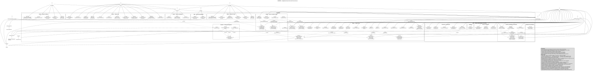

# Diagramas de Casos de Uso

Os diagramas representam os 73 casos de uso da [especificação v2](../../02-produto-e-requisitos/casos-de-uso-v2.md). A primeira figura é a visão completa. As seguintes dividem o sistema por módulo: cada uma repete os atores do módulo e mostra as relações com outros módulos como referência externa.

## Convenções

- Linha cheia sem seta: associação entre ator e caso de uso. Atores em itálico são abstratos.
- Seta com triângulo vazado: generalização entre atores. Tutor e Prestador são Usuários do App; Host, Pet Sitter e Pet Walker são Prestadores.
- `<<include>>`: a seta sai do caso base para o incluído, que sempre é executado.
- `<<extend>>`: a seta sai do caso que estende para o caso base. É opcional e acontece sob a condição entre colchetes.
- "Estar autenticado" é pré-condição, não `<<include>>` de login.
- O Sistema de Pagamento (HPET26, HPET27, HPET28 e HPET28a) é um subsistema interno, não um ator externo.

## Visão completa

## Por módulo

| # | Módulo | Diagrama |
|---|---|---|
| 01 | Web — Área pública e acesso administrativo | [01-web-publico-e-acesso.svg](modulos/01-web-publico-e-acesso.svg) |
| 02 | Web — Usuários, penalidades e moderação | [02-web-usuarios-penalidades-moderacao.svg](modulos/02-web-usuarios-penalidades-moderacao.svg) |
| 03 | Web — Cadastros de prestadores e auditoria | [03-web-cadastros-e-auditoria.svg](modulos/03-web-cadastros-e-auditoria.svg) |
| 04 | Web — Financeiro e contratações | [04-web-financeiro-e-contratacoes.svg](modulos/04-web-financeiro-e-contratacoes.svg) |
| 05a | Mobile — Tutor — Conta e pets | [05a-mobile-tutor-conta-e-pets.svg](modulos/05a-mobile-tutor-conta-e-pets.svg) |
| 05b | Mobile — Tutor — Busca e reservas | [05b-mobile-tutor-busca-e-reservas.svg](modulos/05b-mobile-tutor-busca-e-reservas.svg) |
| 05c | Mobile — Tutor — Pagamentos e descoberta | [05c-mobile-tutor-pagamentos-e-descoberta.svg](modulos/05c-mobile-tutor-pagamentos-e-descoberta.svg) |
| 05d | Mobile — Tutor — Comunicação e avaliações | [05d-mobile-tutor-comunicacao-e-avaliacoes.svg](modulos/05d-mobile-tutor-comunicacao-e-avaliacoes.svg) |
| 06 | Mobile — Todos os usuários do app | [06-mobile-todos-os-usuarios.svg](modulos/06-mobile-todos-os-usuarios.svg) |
| 07 | Mobile — Todos os prestadores | [07-mobile-todos-os-prestadores.svg](modulos/07-mobile-todos-os-prestadores.svg) |
| 08a | Mobile — Host — Perfil e agenda | [08a-mobile-host-perfil-e-agenda.svg](modulos/08a-mobile-host-perfil-e-agenda.svg) |
| 08b | Mobile — Host — Chat e atendimento | [08b-mobile-host-chat-e-atendimento.svg](modulos/08b-mobile-host-chat-e-atendimento.svg) |
| 08c | Mobile — Host — Reservas e rotina | [08c-mobile-host-reservas-e-rotina.svg](modulos/08c-mobile-host-reservas-e-rotina.svg) |
| 09 | Mobile — Pet Sitter | [09-mobile-pet-sitter.svg](modulos/09-mobile-pet-sitter.svg) |
| 10 | Mobile — Pet Walker | [10-mobile-pet-walker.svg](modulos/10-mobile-pet-walker.svg) |
| 11 | Backend — Sistema de Pagamento | [11-backend-pagamentos.svg](modulos/11-backend-pagamentos.svg) |

## Pendências da especificação

- HPET34: a inclusão de Termos de Uso e Política de Privacidade está a confirmar com o PO.
- HPET39: a inclusão do caso está a confirmar com o PO.
- HPET42a: o papel do Responsável pela concessão está a confirmar com o PO (DA-15).
