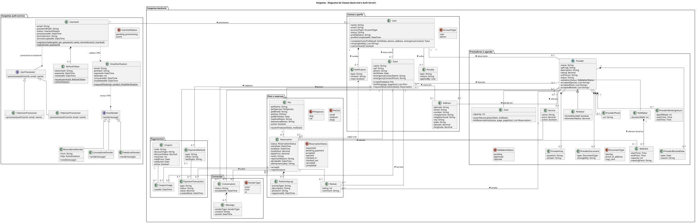
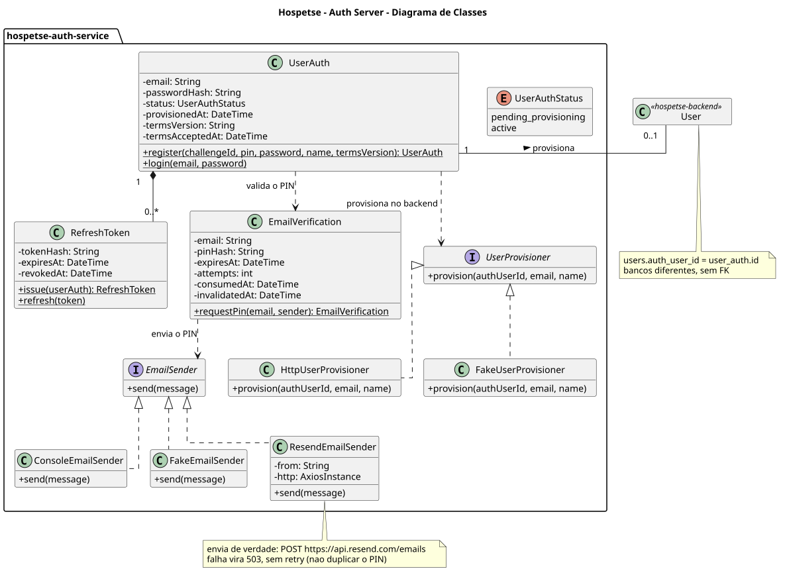

# Diagrama de Classes

O diagrama representa o domínio do back-end principal e do Auth Server. As classes vêm dos modelos do Prisma (`prisma/schema.prisma`) e das funções de service de cada repositório. Quando o schema é mais genérico que a regra de negócio, o diagrama mostra a regra e uma nota indica a diferença.

Os dois serviços têm bancos separados. A ligação entre `User` (back-end) e `UserAuth` (Auth Server) é o valor `users.auth_user_id = user_auth.id`, mantido pela rota interna de provisionamento. Não há chave estrangeira entre eles.

## Visão completa (back-end e Auth Server)

## Auth Server

## Seções do back-end

Cada seção detalha só as próprias classes. Classes de outras seções aparecem só com o nome, com borda tracejada e o nome da seção como estereótipo.

| # | Seção | Diagrama |
|---|---|---|
| 1 | Contas e perfis | [01-contas-e-perfis.svg](secoes/01-contas-e-perfis.svg) |
| 2 | Prestadores e agenda | [02-prestadores-e-agenda.svg](secoes/02-prestadores-e-agenda.svg) |
| 3 | Pets e reservas | [03-pets-e-reservas.svg](secoes/03-pets-e-reservas.svg) |
| 4 | Pagamentos | [04-pagamentos.svg](secoes/04-pagamentos.svg) |
| 5 | Conversas | [05-conversas.svg](secoes/05-conversas.svg) |

O modelo físico das tabelas está no [DER](../der).
