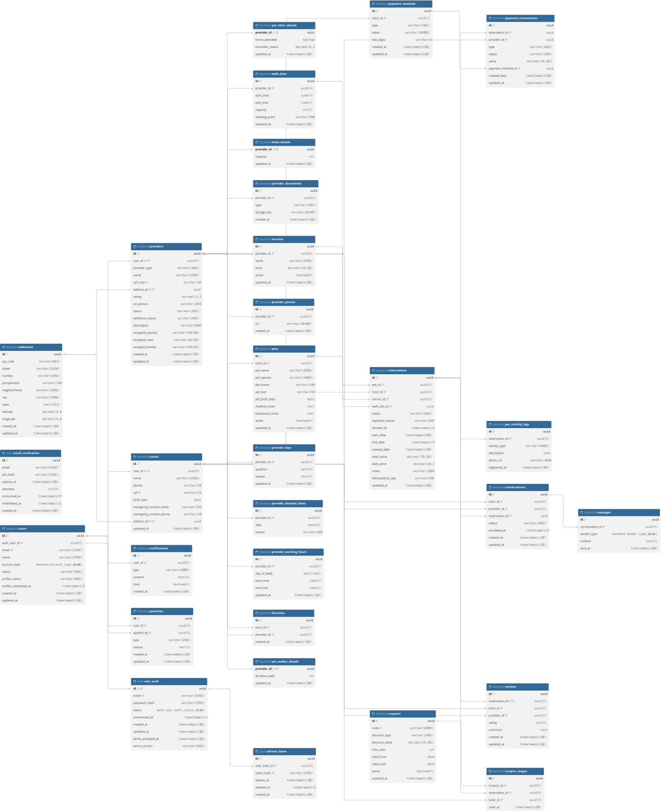

# DER — Diagrama Entidade-Relacionamento

**[der-v3.1.md](der-v3.1.md)**: diagrama e código DBML de todas as tabelas, com os `CHECK` de cada coluna. Também na [Wiki #60](https://dev.azure.com/escola-ti/Hospetse/_wiki/wikis/Hospetse.wiki/60).

O Hospetse tem dois bancos PostgreSQL separados:

| Banco | Serviço | Tabelas |
|---|---|---|
| Auth | `hospetse-auth-service` | `email_verification`, `user_auth` e `refresh_token` |
| Back-end | `hospetse-backend` | Usuários, Tutores, prestadores, pets, serviços, agenda, reservas, avaliações, pagamentos, cupons, conversas, notificações e penalidades |

Não existe chave estrangeira entre os dois bancos. O vínculo é o valor `users.auth_user_id = user_auth.id`, mantido pela chamada interna do Auth Server ao back-end.

A fonte do DER são os arquivos `prisma/schema.prisma` e `prisma/migrations/` de cada repositório. Os `CHECK` das tabelas ficam nas migrations, porque o schema do Prisma não os representa.
