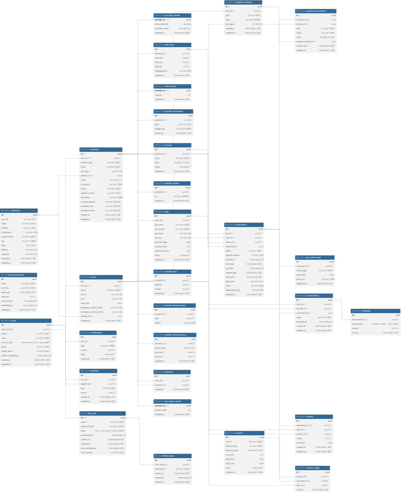

# DER V3.1



Código do diagrama em [DBML](https://dbml.dbdiagram.io), para abrir no [dbdiagram.io](https://dbdiagram.io):

```dbml
// Hospetse: os dois bancos lado a lado, para colar no dbdiagram.io.
// São bancos SEPARADOS: não existe FK entre eles. O vínculo é só o valor
// users.auth_user_id = user_auth.id, mantido pela chamada interna Auth → back-end.
//
// Fonte: prisma/schema.prisma e migrations da develop de cada repositório.
// Back-end: 6 migrations, até 20261030190000_adiciona_aceite_e_recusa_da_solicitacao.
// Os CHECKs não aparecem no schema do Prisma: estão nas notas de cada coluna, copiados das migrations.

Project hospetse {
  database_type: 'PostgreSQL'
}

// ============================================================
// AUTH SERVER (hospetse-auth-service)
// ============================================================

Enum auth.user_auth_status_enum {
  pending_provisioning
  active
}

Table auth.email_verification [headercolor: #2E86C1] {
  id uuid [pk, default: `gen_random_uuid()`, note: 'challengeId']
  email varchar(255) [not null]
  pin_hash varchar(255) [not null, note: 'HMAC-SHA256 do PIN, nunca o PIN']
  expires_at timestamptz(3) [not null]
  attempts int [not null, default: 0]
  consumed_at timestamptz(3)
  invalidated_at timestamptz(3)
  created_at timestamptz(3) [not null, default: `now()`]

  indexes {
    (email, created_at)
    expires_at
  }
}

Table auth.user_auth [headercolor: #2E86C1] {
  id uuid [pk, default: `gen_random_uuid()`, note: 'authUserId: vai no sub do JWT e em users.auth_user_id']
  email varchar(255) [unique, not null]
  password_hash varchar(255) [not null, note: 'Argon2id']
  status auth.user_auth_status_enum [not null, default: 'pending_provisioning']
  provisioned_at timestamptz(3) [note: 'quando o back-end confirmou o USER']
  created_at timestamptz(3) [not null, default: `now()`]
  updated_at timestamptz(3) [not null]
  terms_accepted_at timestamptz(3) [not null, default: `now()`]
  terms_version varchar(64) [not null]
}

Table auth.refresh_token [headercolor: #2E86C1] {
  id uuid [pk, default: `gen_random_uuid()`]
  user_auth_id uuid [not null, ref: > auth.user_auth.id, note: 'ON DELETE CASCADE']
  token_hash varchar(255) [unique, not null, note: 'SHA-256 do token, nunca o token']
  expires_at timestamptz(3) [not null]
  revoked_at timestamptz(3)
  created_at timestamptz(3) [not null, default: `now()`]

  indexes {
    user_auth_id
  }
}

TableGroup auth_server [color: #2E86C1] {
  auth.email_verification
  auth.user_auth
  auth.refresh_token
}

// ============================================================
// BACK-END PRINCIPAL (hospetse-backend)
// ============================================================

Enum backend.account_type_enum {
  user [note: 'Tutor e prestador são deduzidos por tutors/providers (um USER pode ter os dois)']
  admin
}

Enum backend.sender_type_enum {
  tutor
  host
  ai
}

Table backend.users [headercolor: #27AE60] {
  id uuid [pk, default: `gen_random_uuid()`]
  auth_user_id uuid [unique, not null, note: '= auth.user_auth.id (outro banco, sem FK). UNIQUE garante a idempotência do provisionamento (#259, #260)']
  email varchar(255) [unique, not null]
  name varchar(255) [not null, note: 'vem do cadastro, repassado pelo Auth']
  account_type backend.account_type_enum [not null, default: 'user']
  status varchar(20) [not null, default: 'pending', note: 'CHECK: active, blocked, suspended, pending. blocked/suspended bloqueiam a contratação (#263)']
  profile_status varchar(20) [not null, default: 'incomplete', note: 'CHECK: incomplete, complete. complete libera a contratação (#263)']
  profile_completed_at timestamptz(3) [note: 'primeira conclusão do perfil (#275)']
  created_at timestamptz(3) [not null, default: `now()`]
  updated_at timestamptz(3) [not null, default: `now()`]
}

Table backend.addresses [headercolor: #27AE60] {
  id uuid [pk, default: `gen_random_uuid()`]
  zip_code varchar(8) [not null, note: 'só dígitos']
  street varchar(255) [not null]
  number varchar(20) [not null]
  complement varchar(100)
  neighborhood varchar(100) [not null]
  city varchar(100) [not null]
  state char(2) [not null]
  latitude decimal(9,6) [note: 'para a busca por proximidade']
  longitude decimal(9,6)
  created_at timestamptz(3) [not null, default: `now()`]
  updated_at timestamptz(3) [not null, default: `now()`]
}

Table backend.tutors [headercolor: #27AE60] {
  id uuid [pk, default: `gen_random_uuid()`]
  user_id uuid [unique, not null, ref: - backend.users.id, note: 'nasce na conclusão do perfil (PUT /api/v1/me/tutor-profile)']
  name varchar(255) [not null, note: 'copiado de users.name']
  phone varchar(30)
  cpf varchar(14) [unique, note: 'só os 11 dígitos']
  birth_date date
  emergency_contact_name varchar(255)
  emergency_contact_phone varchar(20)
  address_id uuid [unique, ref: - backend.addresses.id]
  updated_at timestamptz(3) [not null, default: `now()`]
}

Table backend.providers [headercolor: #27AE60] {
  id uuid [pk, default: `gen_random_uuid()`]
  user_id uuid [unique, not null, ref: - backend.users.id, note: 'o mesmo USER pode ter tutor e provider; um provider por USER']
  provider_type varchar(30) [not null, note: 'CHECK: hotel, pet_sitter, pet_walker']
  name varchar(255) [not null]
  cpf_cnpj varchar(18) [unique]
  address_id uuid [unique, ref: - backend.addresses.id]
  rating decimal(3,2) [note: 'CHECK: nulo ou entre 0 e 5']
  url_picture varchar(2048)
  status varchar(20) [not null, default: 'active', note: 'CHECK: active, inactive']
  validation_status varchar(20) [not null, default: 'pending', note: 'CHECK: pending, approved, rejected. Só approved aparece nas consultas públicas (#323, #479)']
  description varchar(2000)
  accepted_species "varchar(100)[]" [not null, default: `ARRAY[]::varchar[]`, note: 'mesmos valores de pets.pet_species; vazio = aceita todas']
  accepted_sizes "varchar(30)[]" [not null, default: `ARRAY[]::varchar[]`, note: 'mesmos valores de pets.pet_size; vazio = aceita todos']
  accepted_breeds "varchar(100)[]" [not null, default: `ARRAY[]::varchar[]`, note: 'vazio = aceita todas']
  created_at timestamptz(3) [not null, default: `now()`]
  updated_at timestamptz(3) [not null, default: `now()`]

  indexes {
    provider_type
  }
}

Table backend.provider_photos [headercolor: #27AE60] {
  id uuid [pk, default: `gen_random_uuid()`]
  provider_id uuid [not null, ref: > backend.providers.id, note: 'ON DELETE CASCADE']
  url varchar(2048) [not null]
  created_at timestamptz(3) [not null, default: `now()`]

  indexes {
    provider_id
  }
}

Table backend.provider_documents [headercolor: #27AE60] {
  id uuid [pk, default: `gen_random_uuid()`]
  provider_id uuid [not null, ref: > backend.providers.id, note: 'ON DELETE CASCADE']
  type varchar(30) [not null, note: 'CHECK: identity, proof_of_address, cnpj_card (provisórios, #323). Sem UNIQUE por tipo: frente e verso']
  storage_key varchar(1024) [not null, note: 'chave no armazenamento privado, nunca URL pública (#324)']
  created_at timestamptz(3) [not null, default: `now()`]

  indexes {
    provider_id
  }
}

Table backend.hotel_details [headercolor: #27AE60] {
  provider_id uuid [pk, ref: - backend.providers.id, note: 'ON DELETE CASCADE']
  capacity int [note: 'CHECK: nulo ou >= 0']
  updated_at timestamptz(3) [not null, default: `now()`]
}

Table backend.pet_sitter_details [headercolor: #27AE60] {
  provider_id uuid [pk, ref: - backend.providers.id, note: 'ON DELETE CASCADE']
  home_attended boolean
  kilometer_radius decimal(6,2) [note: 'CHECK: nulo ou >= 0']
  updated_at timestamptz(3) [not null, default: `now()`]
}

Table backend.pet_walker_details [headercolor: #27AE60] {
  provider_id uuid [pk, ref: - backend.providers.id, note: 'ON DELETE CASCADE']
  duration_walk int [note: 'CHECK: nulo ou > 0']
  updated_at timestamptz(3) [not null, default: `now()`]
}

Table backend.pets [headercolor: #27AE60] {
  id uuid [pk, default: `gen_random_uuid()`]
  tutor_id uuid [not null, ref: > backend.tutors.id]
  pet_name varchar(255) [not null]
  pet_species varchar(100) [not null, note: 'validado na aplicação: dog, cat (#369, provisório)']
  pet_breed varchar(100)
  pet_size varchar(30) [note: 'validado na aplicação: small, medium, large (#369, provisório)']
  pet_birth_date date
  medical_notes text
  behavioral_notes text
  active boolean [not null, default: true]
  updated_at timestamptz(3) [not null, default: `now()`]

  indexes {
    tutor_id
  }
}

Table backend.services [headercolor: #27AE60] {
  id uuid [pk, default: `gen_random_uuid()`]
  provider_id uuid [not null, ref: > backend.providers.id]
  name varchar(255) [not null]
  price decimal(10,2) [not null, note: 'CHECK: >= 0. Diária do Host']
  active boolean [not null, default: true]
  updated_at timestamptz(3) [not null, default: `now()`]

  indexes {
    provider_id
  }
}

Table backend.provider_working_hours [headercolor: #27AE60] {
  id uuid [pk, default: `gen_random_uuid()`]
  provider_id uuid [not null, ref: > backend.providers.id, note: 'ON DELETE CASCADE']
  day_of_week smallint [not null, note: 'CHECK: 0 a 6']
  start_time time [not null]
  end_time time [not null, note: 'CHECK: end_time > start_time']
  updated_at timestamptz(3) [not null, default: `now()`]

  indexes {
    (provider_id, day_of_week)
  }
}

Table backend.provider_blocked_dates [headercolor: #27AE60] {
  id uuid [pk, default: `gen_random_uuid()`]
  provider_id uuid [not null, ref: > backend.providers.id, note: 'ON DELETE CASCADE']
  date date [not null, note: 'um dia por linha; a solicitação de hospedagem recusa período com dia bloqueado (#494)']
  reason varchar(500)

  indexes {
    (provider_id, date) [unique]
  }
}

Table backend.walk_slots [headercolor: #27AE60] {
  id uuid [pk, default: `gen_random_uuid()`]
  provider_id uuid [not null, ref: > backend.providers.id, note: 'ON DELETE CASCADE']
  start_time time [not null]
  end_time time [not null, note: 'CHECK: end_time > start_time']
  capacity int [not null, note: 'CHECK: > 0']
  meeting_point varchar(500)
  updated_at timestamptz(3) [not null, default: `now()`]

  indexes {
    provider_id
  }
}

Table backend.reservations [headercolor: #27AE60] {
  id uuid [pk, default: `gen_random_uuid()`]
  pet_id uuid [not null, ref: > backend.pets.id]
  tutor_id uuid [not null, ref: > backend.tutors.id]
  service_id uuid [not null, ref: > backend.services.id]
  walk_slot_id uuid [ref: > backend.walk_slots.id]
  status varchar(20) [not null, default: 'requested', note: 'CHECK: requested, awaiting_payment (aceita pelo Host, #491), accepted, rejected, checked_in, checked_out, cancelled, completed']
  rejection_reason varchar(500) [note: 'motivo da recusa pelo Host (#491)']
  decided_at timestamptz(3) [note: 'momento do aceite ou da recusa (#491)']
  start_date timestamptz(3) [not null]
  end_date timestamptz(3) [note: 'CHECK: nulo ou > start_date']
  created_date timestamptz(3) [not null, default: `now()`]
  total_value decimal(10,2) [not null, note: 'CHECK: >= 0']
  daily_price decimal(10,2) [note: 'snapshot da diária na solicitação (#494)']
  notes varchar(1000) [note: 'observações do Tutor (#494)']
  idempotency_key varchar(100) [note: 'header Idempotency-Key (#494)']
  updated_at timestamptz(3) [not null, default: `now()`]

  indexes {
    (tutor_id, idempotency_key) [unique]
    pet_id
    tutor_id
    service_id
    walk_slot_id
    (status, start_date)
  }
}

Table backend.pet_activity_logs [headercolor: #27AE60] {
  id uuid [pk, default: `gen_random_uuid()`]
  reservation_id uuid [not null, ref: > backend.reservations.id, note: 'ON DELETE CASCADE']
  activity_type varchar(100) [not null]
  description text
  photo_url varchar(2048)
  registered_at timestamptz(3) [not null, default: `now()`]

  indexes {
    (reservation_id, registered_at)
  }
}

Table backend.reviews [headercolor: #27AE60] {
  id uuid [pk, default: `gen_random_uuid()`]
  reservation_id uuid [unique, not null, ref: - backend.reservations.id]
  tutor_id uuid [not null, ref: > backend.tutors.id]
  provider_id uuid [not null, ref: > backend.providers.id]
  rating int [not null, note: 'CHECK: 1 a 5']
  comment text
  created_at timestamptz(3) [not null, default: `now()`]
  updated_at timestamptz(3) [not null, default: `now()`]

  indexes {
    (provider_id, created_at)
    tutor_id
  }
}

Table backend.favorites [headercolor: #27AE60] {
  id uuid [pk, default: `gen_random_uuid()`]
  tutor_id uuid [not null, ref: > backend.tutors.id, note: 'ON DELETE CASCADE']
  provider_id uuid [not null, ref: > backend.providers.id, note: 'ON DELETE CASCADE']
  created_at timestamptz(3) [not null, default: `now()`]

  indexes {
    (tutor_id, provider_id) [unique]
    provider_id
  }
}

Table backend.payment_methods [headercolor: #27AE60] {
  id uuid [pk, default: `gen_random_uuid()`]
  tutor_id uuid [not null, ref: > backend.tutors.id]
  type varchar(20) [not null, note: 'CHECK: credit_card, debit_card, pix, boleto']
  token varchar(2048) [not null]
  last_digits varchar(4)
  created_at timestamptz(3) [not null, default: `now()`]
  updated_at timestamptz(3) [not null, default: `now()`]

  indexes {
    tutor_id
  }
}

Table backend.payment_transactions [headercolor: #27AE60] {
  id uuid [pk, default: `gen_random_uuid()`]
  reservation_id uuid [ref: > backend.reservations.id]
  provider_id uuid [ref: > backend.providers.id]
  type varchar(20) [not null, note: 'CHECK: payment, refund, payout']
  status varchar(20) [not null, default: 'pending', note: 'CHECK: pending, approved, rejected, completed']
  value decimal(10,2) [not null, note: 'CHECK: >= 0']
  payment_method_id uuid [ref: > backend.payment_methods.id]
  created_date timestamptz(3) [not null, default: `now()`]
  updated_at timestamptz(3) [not null, default: `now()`]

  Note: 'CHECK payment_transactions_subject_check: a transação aponta para uma reserva ou para um prestador, conforme o tipo'

  indexes {
    reservation_id
    provider_id
    payment_method_id
    (type, status)
  }
}

Table backend.coupons [headercolor: #27AE60] {
  id uuid [pk, default: `gen_random_uuid()`]
  code varchar(100) [unique, not null]
  discount_type varchar(20) [not null, note: 'CHECK: percentage, fixed']
  discount_value decimal(10,2) [not null, note: 'CHECK: >= 0']
  max_uses int [note: 'CHECK: nulo ou > 0']
  valid_from date
  valid_until date [note: 'CHECK: valid_until >= valid_from quando os dois existem']
  active boolean [not null, default: true]
  updated_at timestamptz(3) [not null, default: `now()`]
}

Table backend.coupon_usages [headercolor: #27AE60] {
  id uuid [pk, default: `gen_random_uuid()`]
  coupon_id uuid [not null, ref: > backend.coupons.id]
  reservation_id uuid [not null, ref: > backend.reservations.id]
  tutor_id uuid [not null, ref: > backend.tutors.id]
  used_at timestamptz(3) [not null, default: `now()`]

  indexes {
    (coupon_id, reservation_id) [unique]
    tutor_id
  }
}

Table backend.conversations [headercolor: #27AE60] {
  id uuid [pk, default: `gen_random_uuid()`]
  tutor_id uuid [not null, ref: > backend.tutors.id]
  provider_id uuid [not null, ref: > backend.providers.id]
  reservation_id uuid [ref: > backend.reservations.id]
  status varchar(20) [not null, default: 'ai_handling', note: 'CHECK: ai_handling, escalated, human_handling, closed']
  escalated_at timestamptz(3)
  created_at timestamptz(3) [not null, default: `now()`]
  updated_at timestamptz(3) [not null, default: `now()`]

  indexes {
    tutor_id
    provider_id
    reservation_id
    (status, escalated_at)
  }
}

Table backend.messages [headercolor: #27AE60] {
  id uuid [pk, default: `gen_random_uuid()`]
  conversation_id uuid [not null, ref: > backend.conversations.id, note: 'ON DELETE CASCADE']
  sender_type backend.sender_type_enum [not null]
  content text [not null]
  sent_at timestamptz(3) [not null, default: `now()`]

  indexes {
    (conversation_id, sent_at)
  }
}

Table backend.provider_faqs [headercolor: #27AE60] {
  id uuid [pk, default: `gen_random_uuid()`]
  provider_id uuid [not null, ref: > backend.providers.id, note: 'ON DELETE CASCADE']
  question text [not null]
  answer text [not null]
  updated_at timestamptz(3) [not null, default: `now()`]

  indexes {
    provider_id
  }
}

Table backend.notifications [headercolor: #27AE60] {
  id uuid [pk, default: `gen_random_uuid()`]
  user_id uuid [not null, ref: > backend.users.id, note: 'ON DELETE CASCADE']
  type varchar(100) [not null]
  content text [not null]
  read boolean [not null, default: false]
  created_at timestamptz(3) [not null, default: `now()`]

  indexes {
    (user_id, read, created_at)
  }
}

Table backend.penalties [headercolor: #27AE60] {
  id uuid [pk, default: `gen_random_uuid()`]
  user_id uuid [not null, ref: > backend.users.id]
  applied_by uuid [not null, ref: > backend.users.id]
  type varchar(20) [not null, note: 'CHECK: warning, fine, suspension, ban']
  reason text [not null]
  created_at timestamptz(3) [not null, default: `now()`]
  updated_at timestamptz(3) [not null, default: `now()`]

  indexes {
    (user_id, created_at)
    applied_by
  }
}

// ============================================================
// VÍNCULO ENTRE OS BANCOS (lógico, NÃO é FK de verdade)
// Desenhado só para visualizar: cada banco é separado, então o PostgreSQL
// não garante esse vínculo. Quem mantém é a chamada interna Auth → back-end.
// ============================================================

Ref vinculo_auth_backend: backend.users.auth_user_id - auth.user_auth.id [color: #E67E22]

TableGroup backend [color: #27AE60] {
  backend.users
  backend.addresses
  backend.tutors
  backend.providers
  backend.provider_photos
  backend.provider_documents
  backend.hotel_details
  backend.pet_sitter_details
  backend.pet_walker_details
  backend.pets
  backend.services
  backend.provider_working_hours
  backend.provider_blocked_dates
  backend.walk_slots
  backend.reservations
  backend.pet_activity_logs
  backend.reviews
  backend.favorites
  backend.payment_methods
  backend.payment_transactions
  backend.coupons
  backend.coupon_usages
  backend.conversations
  backend.messages
  backend.provider_faqs
  backend.notifications
  backend.penalties
}
```
