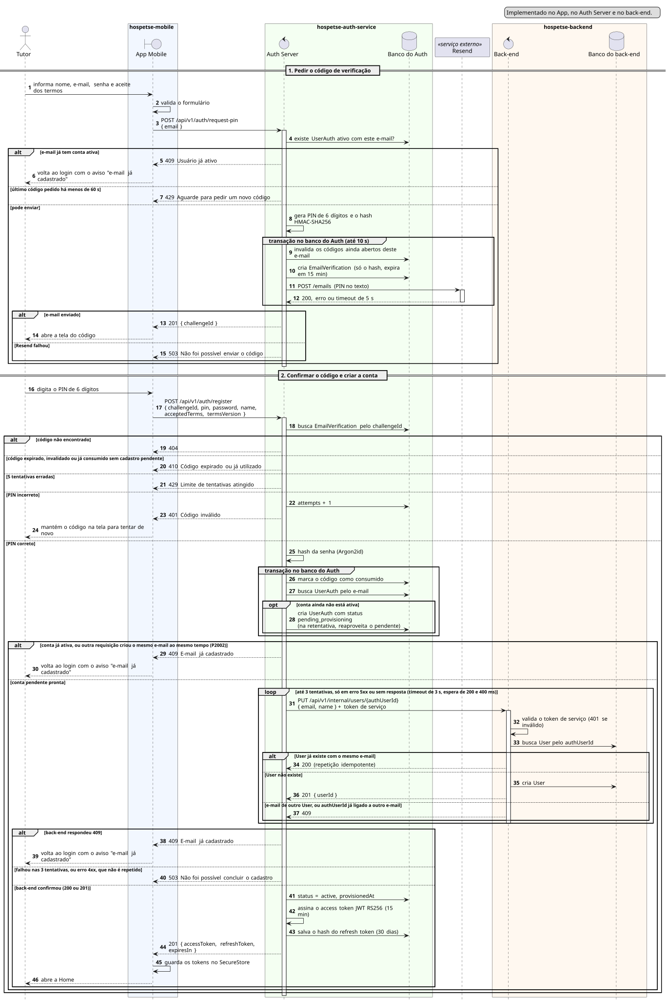

# Sequência 1: Cadastro com PIN e provisionamento

**Tipo:** 1, Identidade. **Caso de uso representado:** HPET01 Cadastrar-se. **Situação:** implementado no App, no Auth Server e no back-end.

O diagrama mostra como um Tutor cria a conta. Ele passa por três serviços: o aplicativo, o Auth Server, que guarda a identidade, e o back-end, que guarda os dados do negócio. O e-mail com o código de verificação é enviado por um serviço externo, o Resend.

## Participantes

| Participante | Ícone | Repositório | Papel |
|---|---|---|---|
| Tutor | ator (bonequinho) | — | pessoa que se cadastra |
| App Mobile | fronteira (`boundary`) | `hospetse-mobile` | telas de cadastro e de código |
| Auth Server | controle (`control`) | `hospetse-auth-service` | valida o PIN, cria a identidade e emite os tokens |
| Banco do Auth | banco (`database`) | `hospetse-auth-service` | códigos de verificação, contas e refresh tokens |
| Resend | participante com estereótipo «serviço externo» | — | envia o e-mail com o PIN |
| Back-end | controle (`control`) | `hospetse-backend` | cria o usuário do negócio |
| Banco do back-end | banco (`database`) | `hospetse-backend` | usuários do negócio |

## Como ler os símbolos

- **Seta cheia:** uma chamada. **Seta tracejada:** a resposta. **Seta que volta ao mesmo participante:** trabalho interno, sem chamar ninguém.
- **Retângulo fino sobre a linha de vida:** o participante está processando.
- **`alt`:** decisão do tipo "se/senão". Os ramos são separados por linha tracejada e só um acontece.
- **`loop`:** passos que se repetem enquanto a condição do cabeçalho valer.
- **`group`:** só agrupa passos com um nome. Aqui marca uma transação no banco.

## Parte 1: pedir o código de verificação

1. **Tutor → App:** o Tutor informa nome, e-mail, senha e o aceite dos termos.
2. **App → App:** o aplicativo valida o formulário antes de chamar o servidor.
3. **App → Auth Server:** o aplicativo envia `POST /api/v1/auth/request-pin` só com o e-mail. Nome e senha ficam guardados na memória do aparelho até a próxima tela.
4. **Auth Server → Banco do Auth:** o Auth verifica se já existe uma conta ativa com esse e-mail.

**`alt`: o código pode ser enviado?**

*Ramo "e-mail já tem conta ativa":*

5. **Auth Server → App:** `409 Usuário já ativo`.
6. **App → Tutor:** o aplicativo volta ao login com o aviso de que o e-mail já tem cadastro. O fluxo termina.

*Ramo "último código pedido há menos de 60 s":*

7. **Auth Server → App:** `429`, pedindo para aguardar. Isso evita que alguém dispare vários e-mails seguidos.

*Ramo "pode enviar":*

8. **Auth Server → Auth Server:** o Auth gera um PIN de 6 dígitos e calcula o hash HMAC-SHA256 dele. O PIN em texto nunca é gravado.

**`group`: transação no banco do Auth (até 10 s).** Os passos 9 a 12 acontecem juntos: ou todos valem, ou nenhum vale.

9. **Auth Server → Banco do Auth:** invalida os códigos ainda abertos desse e-mail. Só o código mais novo continua válido.
10. **Auth Server → Banco do Auth:** cria o registro do código (`EmailVerification`) com o hash e a validade de 15 minutos.
11. **Auth Server → Resend:** envia o e-mail com o PIN (`POST /emails`).
12. **Resend → Auth Server:** responde que aceitou, responde com erro, ou não responde em 5 segundos.

**`alt`: o e-mail saiu?**

*Ramo "e-mail enviado":*

13. **Auth Server → App:** `201` com o `challengeId`, que identifica esse pedido de código.
14. **App → Tutor:** abre a tela para digitar o código.

*Ramo "Resend falhou":*

- **Observação:** como o envio fica dentro da transação, a falha desfaz o passo 10. Nenhum código fica salvo sem ter sido enviado.

15. **Auth Server → App:** `503`, não foi possível enviar o código. O fluxo termina.

- **Observação depois da parte 1:** sem a variável `RESEND_API_KEY`, o Auth usa o `ConsoleEmailSender`, que mostra o PIN no log. Isso só serve para desenvolvimento.

## Parte 2: confirmar o código e criar a conta

16. **Tutor → App:** o Tutor digita o PIN de 6 dígitos.
17. **App → Auth Server:** `POST /api/v1/auth/register` com `challengeId`, PIN, senha, nome, aceite e versão dos termos. O e-mail não vai: o Auth usa o do código.
18. **Auth Server → Banco do Auth:** busca o código pelo `challengeId`.

**`alt`: o código e o PIN são válidos?**

*Ramo "código não encontrado":*

19. **Auth Server → App:** `404`.

*Ramo "código expirado, invalidado ou já consumido sem cadastro pendente":*

20. **Auth Server → App:** `410`, código expirado ou já utilizado. Um código já consumido só volta a valer como retentativa de um cadastro que ficou pendente (ver o passo 40).

*Ramo "5 tentativas erradas":*

21. **Auth Server → App:** `429`, limite de tentativas atingido.

*Ramo "PIN incorreto":*

22. **Auth Server → Banco do Auth:** soma 1 às tentativas do código. A comparação do hash é feita em tempo constante, para o tempo de resposta não revelar quantos dígitos estavam certos.
23. **Auth Server → App:** `401`, código inválido.
24. **App → Tutor:** o código digitado continua na tela para tentar de novo.

*Ramo "PIN correto":*

25. **Auth Server → Auth Server:** calcula o hash da senha com Argon2id. Fica fora da transação porque é lento de propósito.

**`group`: transação no banco do Auth.**

26. **Auth Server → Banco do Auth:** marca o código como consumido, só se ele ainda estiver aberto. Se outra requisição consumiu antes, esta falha com `410`.
27. **Auth Server → Banco do Auth:** busca a conta (`UserAuth`) pelo e-mail.
28. **Auth Server → Banco do Auth:** se a conta ainda não está ativa, cria com status `pending_provisioning`. Numa retentativa, reaproveita a conta pendente, mantendo o mesmo id.

**`alt`: a conta pode seguir?**

*Ramo "conta já ativa, ou outra requisição criou o mesmo e-mail ao mesmo tempo":*

- **Observação:** o erro desfaz a transação, então o código não fica consumido. O segundo caso é o `P2002`, a violação do índice único do e-mail.

29. **Auth Server → App:** `409`, e-mail já cadastrado.
30. **App → Tutor:** volta ao login com o aviso de e-mail cadastrado.

*Ramo "conta pendente pronta":* o resto da parte 2 está dentro deste ramo.

**`loop`: até 3 tentativas.** O Auth repete a chamada só em falha passageira: erro 5xx ou nenhuma resposta. Cada tentativa espera até 3 segundos, e entre elas há uma pausa de 200 ms e depois de 400 ms.

31. **Auth Server → Back-end:** `PUT /api/v1/internal/users/{authUserId}` com e-mail e nome, usando o token de serviço. O `authUserId` é o id da conta criada no passo 28.
32. **Back-end → Back-end:** confere o token de serviço. Se for inválido, responde `401`. Esse erro não é repetido pelo `loop` e vira o `503` do passo 40.
33. **Back-end → Banco do back-end:** procura um usuário com esse `authUserId`.

**`alt` dentro do `loop`: o usuário já existe?**

*Ramo "User já existe com o mesmo e-mail":*

34. **Back-end → Auth Server:** `200`. É uma repetição da mesma chamada, e o back-end não cria nada de novo. Por isso a rota pode ser chamada várias vezes com segurança (idempotência).

*Ramo "User não existe":*

35. **Back-end → Banco do back-end:** cria o usuário do negócio (`User`).
36. **Back-end → Auth Server:** `201` com o `userId`.

*Ramo "e-mail de outro User, ou authUserId já ligado a outro e-mail":*

37. **Back-end → Auth Server:** `409`, com `EMAIL_ALREADY_IN_USE` ou `AUTH_USER_ID_CONFLICT`.

**`alt`: como terminou o provisionamento?**

*Ramo "back-end respondeu 409":*

38. **Auth Server → App:** `409`, e-mail já cadastrado.
39. **App → Tutor:** volta ao login com o aviso de e-mail cadastrado.

*Ramo "falhou nas 3 tentativas, ou erro 4xx, que não é repetido":*

40. **Auth Server → App:** `503`, não foi possível concluir o cadastro.

- **Observação:** a conta continua em `pending_provisioning`, e o mesmo PIN serve para tentar de novo (é o caso de retentativa do passo 20).

*Ramo "back-end confirmou (200 ou 201)":*

41. **Auth Server → Banco do Auth:** muda a conta para `active` e grava a data do provisionamento.
42. **Auth Server → Auth Server:** assina o access token JWT RS256, válido por 15 minutos.
43. **Auth Server → Banco do Auth:** gera o refresh token, válido por 30 dias, e grava só o hash dele.
44. **Auth Server → App:** `201` com `accessToken`, `refreshToken` e `expiresIn`.
45. **App → App:** guarda os dois tokens no SecureStore do aparelho.
46. **App → Tutor:** abre a Home.

**Observações finais:**

- O back-end cria só o `User`. O `Tutor` nasce depois, quando o perfil é completado (`PUT /api/v1/me/tutor-profile`).
- O token só é emitido depois que o back-end confirma o usuário (ADR-011). Assim nunca existe um token de uma conta sem usuário no back-end.

## Fora do diagrama

- O `400` do Auth para e-mail em formato inválido. O passo 2 já valida o formato no aplicativo.
- O botão "reenviar código" da tela do PIN, que repete a parte 1 com o mesmo e-mail.
