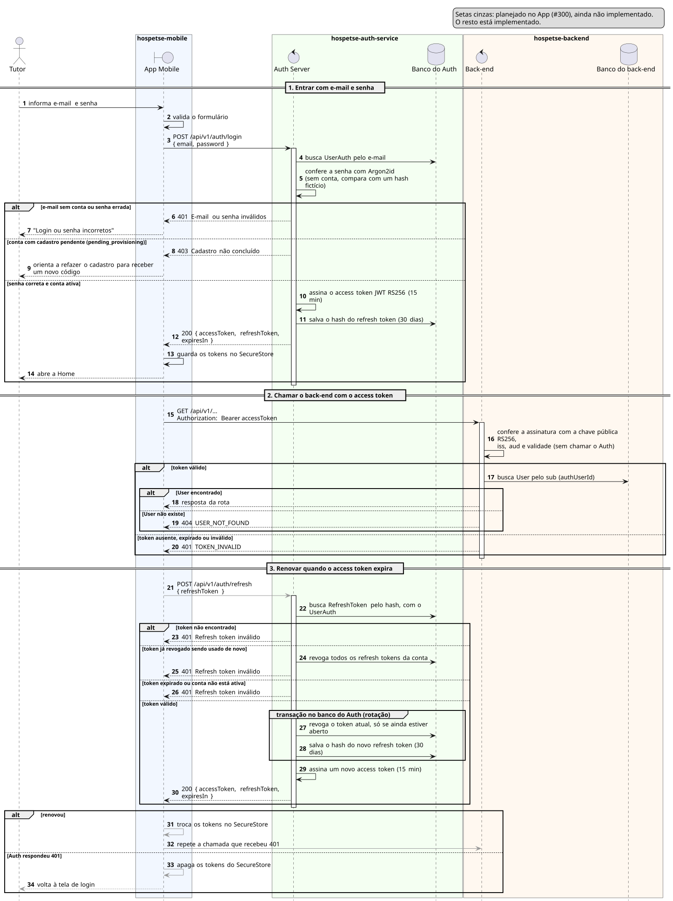

# Sequência 2: Login e renovação do token

**Tipo:** 1, Identidade. **Caso de uso representado:** HPET01a Autenticar-se (Login). **Situação:** login implementado no App e no Auth Server; validação do token implementada no back-end; renovação implementada no Auth Server e planejada no App (#300).

O diagrama mostra três momentos da vida do acesso: entrar com e-mail e senha, usar o token nas chamadas ao back-end e renovar o token quando ele expira.

## Participantes

| Participante | Ícone | Repositório | Papel |
|---|---|---|---|
| Tutor | ator (bonequinho) | — | pessoa que entra no aplicativo |
| App Mobile | fronteira (`boundary`) | `hospetse-mobile` | tela de login e guarda dos tokens |
| Auth Server | controle (`control`) | `hospetse-auth-service` | confere a senha, emite e renova os tokens |
| Banco do Auth | banco (`database`) | `hospetse-auth-service` | contas e refresh tokens |
| Back-end | controle (`control`) | `hospetse-backend` | confere o token em cada chamada |
| Banco do back-end | banco (`database`) | `hospetse-backend` | usuários do negócio |

## Como ler os símbolos

- **Seta cheia:** uma chamada. **Seta tracejada:** a resposta. **Seta que volta ao mesmo participante:** trabalho interno.
- **Seta cinza:** passo planejado no App, ainda não implementado.
- **Retângulo fino sobre a linha de vida:** o participante está processando.
- **`alt`:** decisão do tipo "se/senão". Só um ramo acontece.
- **`group`:** agrupa passos com um nome. Aqui marca uma transação no banco.

## Parte 1: entrar com e-mail e senha

1. **Tutor → App:** o Tutor informa e-mail e senha.
2. **App → App:** o aplicativo valida o formulário.
3. **App → Auth Server:** `POST /api/v1/auth/login` com e-mail e senha.
4. **Auth Server → Banco do Auth:** busca a conta pelo e-mail.
5. **Auth Server → Auth Server:** confere a senha com Argon2id. Se o e-mail não tem conta, compara a senha com um hash fictício.

- **Observação:** a comparação com o hash fictício faz o tempo de resposta ser o mesmo com ou sem conta. Assim ninguém descobre quais e-mails estão cadastrados medindo o tempo.

**`alt`: a senha confere e a conta está ativa?**

*Ramo "e-mail sem conta ou senha errada":*

6. **Auth Server → App:** `401`, e-mail ou senha inválidos. A mensagem é a mesma nos dois casos.
7. **App → Tutor:** "Login ou senha incorretos".

*Ramo "conta com cadastro pendente (`pending_provisioning`)":*

8. **Auth Server → App:** `403`, cadastro não concluído. Essa resposta só aparece depois da senha certa: quem não sabe a senha não descobre que existe um cadastro pela metade.
9. **App → Tutor:** orienta a refazer o cadastro para receber um novo código.

*Ramo "senha correta e conta ativa":*

10. **Auth Server → Auth Server:** assina o access token JWT RS256, válido por 15 minutos.
11. **Auth Server → Banco do Auth:** gera o refresh token, válido por 30 dias, e grava só o hash dele.
12. **Auth Server → App:** `200` com `accessToken`, `refreshToken` e `expiresIn`.
13. **App → App:** guarda os tokens no SecureStore. A senha não é guardada em lugar nenhum.
14. **App → Tutor:** abre a Home.

- **Observação depois da parte 1:** a HPET01a (Revisão v2) também pede para barrar conta suspensa, banida ou inativa. O Auth ainda só distingue `active` de `pending_provisioning`.

## Parte 2: chamar o back-end com o access token

15. **App → Back-end:** uma chamada a qualquer rota protegida (`/api/v1/...`) com o header `Authorization: Bearer accessToken`. Hoje o aplicativo ainda não chama nenhuma rota do back-end: a Home e a busca usam dados de exemplo.
16. **Back-end → Back-end:** confere o token com a chave pública RS256: assinatura, emissor (`iss`), destinatário (`aud`) e validade. O back-end não chama o Auth para isso.

**`alt`: o token é válido?**

*Ramo "token válido":*

17. **Back-end → Banco do back-end:** busca o usuário pelo `sub` do token, que é o `authUserId`.

**`alt` dentro do ramo: o usuário existe?**

- *Ramo "User encontrado":* 18. **Back-end → App:** a resposta da rota pedida.
- *Ramo "User não existe":* 19. **Back-end → App:** `404 USER_NOT_FOUND`.

*Ramo "token ausente, expirado ou inválido":*

20. **Back-end → App:** `401 TOKEN_INVALID`. É esse `401` que dispara a parte 3.

## Parte 3: renovar quando o access token expira

21. **App → Auth Server (cinza):** `POST /api/v1/auth/refresh` com o refresh token. O aplicativo ainda não faz essa chamada.
22. **Auth Server → Banco do Auth:** busca o refresh token pelo hash, junto com a conta.

**`alt`: o refresh token pode ser usado?**

*Ramo "token não encontrado":*

23. **Auth Server → App:** `401`, refresh token inválido.

*Ramo "token já revogado sendo usado de novo":*

24. **Auth Server → Banco do Auth:** revoga todos os refresh tokens da conta.

- **Observação:** usar de novo um token já trocado indica que existe uma cópia dele. Revogar tudo força um novo login em todos os aparelhos.

25. **Auth Server → App:** `401`.

*Ramo "token expirado ou conta não está ativa":*

26. **Auth Server → App:** `401`.

*Ramo "token válido":*

**`group`: transação no banco do Auth (rotação).** O token antigo e o novo mudam juntos.

27. **Auth Server → Banco do Auth:** revoga o token atual, só se ele ainda estiver aberto.
28. **Auth Server → Banco do Auth:** gera um novo refresh token e grava o hash dele.

- **Observação:** se duas requisições usarem o mesmo token ao mesmo tempo, só uma encontra o token aberto no passo 27. A outra recebe `401`.

29. **Auth Server → Auth Server:** assina um novo access token de 15 minutos.
30. **Auth Server → App:** `200` com os tokens novos.

**`alt` no App: o que fazer com a resposta?** Todos os passos deste bloco são planejados (cinza).

- *Ramo "renovou":*
  31. **App → App:** troca os tokens no SecureStore.
  32. **App → Back-end:** repete a chamada que tinha recebido `401`.
- *Ramo "Auth respondeu 401":*
  33. **App → App:** apaga os tokens do SecureStore.
  34. **App → Tutor:** volta à tela de login.

**Observações finais:**

- Os quatro `401` da renovação têm a mesma mensagem: o cliente não descobre por que o token falhou.
- O Auth guarda só o hash do refresh token. O token em si fica apenas no aparelho.

## Fora do diagrama

- O `400` do login para e-mail em formato inválido. O passo 2 já valida o formato no aplicativo.
