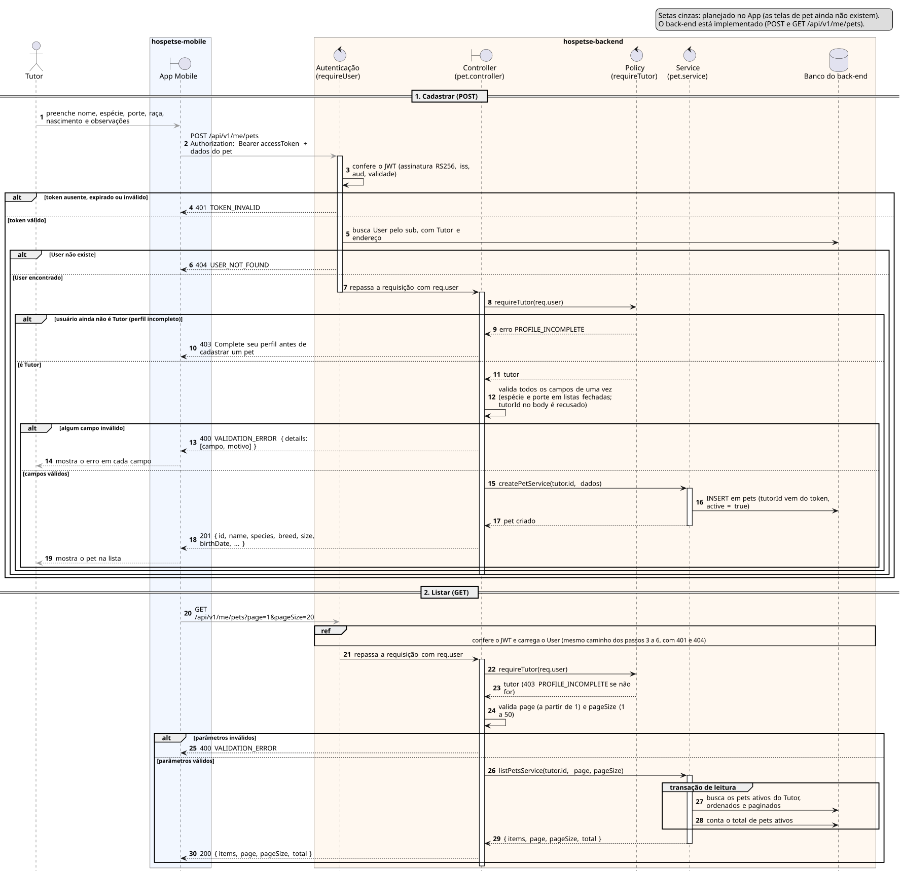

# Sequência 3: CRUD genérico (exemplo: cadastro de pet)

**Tipo:** 2, CRUD do próprio recurso (17 casos de uso). **Caso de uso representado:** HPET02 Cadastrar Pet. **Situação:** cadastrar e listar implementados no back-end; telas de pet planejadas no App.

O diagrama usa o cadastro e a listagem de pets como exemplo do caminho que todo CRUD do Hospetse percorre dentro do back-end. Por isso o back-end aparece dividido em camadas: o que se repete entre os 17 casos é justamente a passagem por elas.

## Participantes

| Participante | Ícone | No código | Papel |
|---|---|---|---|
| Tutor | ator (bonequinho) | — | dono do pet |
| App Mobile | fronteira (`boundary`) | `hospetse-mobile` | telas de pet (ainda não existem) |
| Autenticação | controle (`control`) | `requireUser` (`middlewares/user-token.js`) | confere o token e carrega o usuário |
| Controller | fronteira (`boundary`) | `pets/pet.controller.js` | ponta HTTP: valida campos e monta a resposta |
| Policy | controle (`control`) | `requireTutor` (`pets/pet-policy.js`) | confere se o usuário tem o papel exigido |
| Service | controle (`control`) | `pets/pet.service.js` | regra de negócio e acesso ao banco |
| Banco do back-end | banco (`database`) | tabela `pets` | guarda os pets |

## Como ler os símbolos

- **Seta cheia:** uma chamada. **Seta tracejada:** a resposta. **Seta que volta ao mesmo participante:** trabalho interno.
- **Seta cinza:** passo planejado no App, ainda não implementado.
- **Retângulo fino sobre a linha de vida:** o participante está processando.
- **`alt`:** decisão do tipo "se/senão". Só um ramo acontece. Um `alt` pode ficar dentro de outro.
- **`ref`:** trecho já desenhado, que não é repetido.
- **`group`:** agrupa passos com um nome. Aqui marca uma transação no banco.

## Parte 1: cadastrar (POST)

1. **Tutor → App (cinza):** o Tutor preenche nome, espécie, porte, raça, data de nascimento e observações do pet.
2. **App → Autenticação (cinza):** `POST /api/v1/me/pets` com o token no header e os dados do pet no corpo.
3. **Autenticação → Autenticação:** confere o JWT: assinatura RS256, emissor, destinatário e validade. Toda rota sob `/api/v1` passa por aqui antes de chegar ao controller.

**`alt`: o token é válido?**

*Ramo "token ausente, expirado ou inválido":*

4. **Autenticação → App:** `401 TOKEN_INVALID`.

*Ramo "token válido":*

5. **Autenticação → Banco:** busca o usuário pelo `sub` do token, junto com o perfil de Tutor e o endereço.

**`alt` dentro do ramo: o usuário existe?**

*Ramo "User não existe":*

6. **Autenticação → App:** `404 USER_NOT_FOUND`.

*Ramo "User encontrado":*

7. **Autenticação → Controller:** repassa a requisição com o usuário em `req.user`. A ativação da autenticação termina e começa a do controller.
8. **Controller → Policy:** `requireTutor(req.user)`. Só quem tem perfil de Tutor pode ter pet.

**`alt`: o usuário já é Tutor?**

*Ramo "usuário ainda não é Tutor (perfil incompleto)":* o perfil de Tutor só nasce quando o perfil é completado.

9. **Policy → Controller:** erro `PROFILE_INCOMPLETE`.
10. **Controller → App:** `403`, complete seu perfil antes de cadastrar um pet.

*Ramo "é Tutor":*

11. **Policy → Controller:** devolve o Tutor.
12. **Controller → Controller:** valida todos os campos de uma vez. Espécie e porte precisam estar nas listas fechadas, a data não pode ser futura, e campos fora do contrato, como um `tutorId` no corpo, são recusados.

**`alt`: os campos são válidos?**

*Ramo "algum campo inválido":*

13. **Controller → App:** `400 VALIDATION_ERROR` com a lista de campos e o motivo de cada um.
14. **App → Tutor (cinza):** mostra o erro em cada campo.

*Ramo "campos válidos":*

15. **Controller → Service:** `createPetService(tutor.id, dados)`. O id do Tutor vem do token, não da requisição.
16. **Service → Banco:** grava o pet em `pets`, ligado ao Tutor e com `active = true`.
17. **Service → Controller:** devolve o pet criado.
18. **Controller → App:** `201` com o pet, usando os nomes do contrato da API (`name`, `species`, `breed`, `size`, `birthDate`…).
19. **App → Tutor (cinza):** mostra o pet na lista.

## Parte 2: listar (GET)

20. **App → Autenticação (cinza):** `GET /api/v1/me/pets?page=1&pageSize=20`.

**`ref`: confere o JWT e carrega o usuário.** É o mesmo caminho dos passos 3 a 6, com os mesmos `401` e `404`. O diagrama não repete esse trecho.

21. **Autenticação → Controller:** repassa a requisição com `req.user`.
22. **Controller → Policy:** `requireTutor(req.user)`.
23. **Policy → Controller:** devolve o Tutor. Se o usuário não for Tutor, a resposta é o mesmo `403` do passo 10.
24. **Controller → Controller:** valida a paginação: `page` a partir de 1 e `pageSize` de 1 a 50.

**`alt`: os parâmetros são válidos?**

*Ramo "parâmetros inválidos":*

25. **Controller → App:** `400 VALIDATION_ERROR`.

*Ramo "parâmetros válidos":*

26. **Controller → Service:** `listPetsService(tutor.id, page, pageSize)`.

**`group`: transação de leitura.** As duas consultas rodam juntas, para o total bater com a página.

27. **Service → Banco:** busca os pets ativos do Tutor, ordenados e paginados. Pets inativos não aparecem.
28. **Service → Banco:** conta o total de pets ativos.

29. **Service → Controller:** `{ items, page, pageSize, total }`.
30. **Controller → App:** `200` com a página e o total.

## O que vale para os 17 casos do tipo 2

O padrão: autenticação, policy que confere o papel, controller que valida os campos, service, banco e resposta. O que muda de um caso para outro:

- **Papel exigido:** `requireTutor` (pet, perfil, favorito, avaliação), `requireHost` (agenda, preços, perfil de Host) ou Administrador (cupons, taxa).
- **Regra de bloqueio no service:** HPET02b não inativa pet com reserva ativa ou futura; HPET08 aceita uma avaliação por contratação.
- **Revalidação:** HPET10a, HPET16a e HPET18a mandam o perfil de volta à fila de validação (tipo 7).
- **Auditoria:** HPET40 e HPET41 registram a ação do Administrador.
- **Editar e inativar:** seguem o mesmo caminho com PUT ou PATCH. Inativar é lógico (`active = false`) e não apaga o registro.
- **Dono do recurso:** sai sempre do token, nunca do corpo da requisição.

## Fora do diagrama

- Editar e inativar pet (HPET02a e HPET02b) ainda não existem no back-end. Só cadastrar e listar estão implementados.
