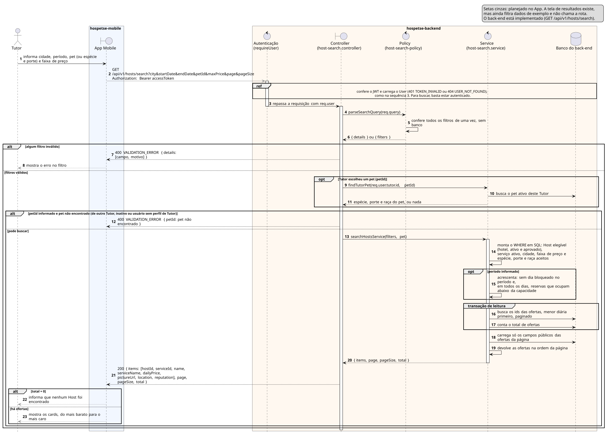

# Sequência 4: Consulta genérica (exemplo: busca de Host)

**Tipo:** 3, Consulta e relatório (16 casos de uso). **Caso de uso representado:** HPET03 Buscar Serviços. **Situação:** implementado no back-end (`GET /api/v1/hosts/search`); a tela de resultados existe no App, mas ainda filtra dados de exemplo e não chama a rota.

O diagrama usa a busca de Hosts como exemplo de consulta. É a consulta mais completa do sistema: aplica as restrições do pet, calcula a disponibilidade no período e devolve só dados públicos de outra pessoa.

## Participantes

| Participante | Ícone | No código | Papel |
|---|---|---|---|
| Tutor | ator (bonequinho) | — | quem busca um Host |
| App Mobile | fronteira (`boundary`) | `hospetse-mobile` | tela de busca e de resultados |
| Autenticação | controle (`control`) | `requireUser` | confere o token e carrega o usuário |
| Controller | fronteira (`boundary`) | `hosts/host-search.controller.js` | ponta HTTP |
| Policy | controle (`control`) | `hosts/host-search-policy.js` | confere os filtros, sem banco |
| Service | controle (`control`) | `hosts/host-search.service.js` | monta a consulta e busca no banco |
| Banco do back-end | banco (`database`) | `services`, `providers`, `addresses`, `reservations` e outras | dados consultados |

## Como ler os símbolos

- **Seta cheia:** uma chamada. **Seta tracejada:** a resposta. **Seta que volta ao mesmo participante:** trabalho interno.
- **Seta cinza:** passo planejado no App, ainda não implementado.
- **Retângulo fino sobre a linha de vida:** o participante está processando.
- **`alt`:** decisão do tipo "se/senão". Os ramos são separados por linha tracejada e só um acontece.
- **`opt`:** decisão do tipo "se", sem senão. O conteúdo acontece ou é pulado.
- **`ref`:** trecho já desenhado em outro diagrama, que não é repetido.
- **`group`:** agrupa passos com um nome. Aqui marca uma transação no banco.

Regra para não confundir: se o "não" também tem passos próprios, é `alt`; se o "não" só significa pular, é `opt`.

## Narração

1. **Tutor → App:** o Tutor preenche a busca. O diagrama mostra cidade, período, pet e faixa de preço, que são os filtros da API. O formulário atual do aplicativo pede outros filtros: cidade, tipo de serviço, porte, preço máximo e comodidades.
2. **App → Autenticação (cinza):** `GET /api/v1/hosts/search` com os filtros na URL e o token no header. O aplicativo ainda não faz essa chamada.

**`ref`: confere o JWT e carrega o usuário.** É o mesmo caminho da sequência 3. Se o token falhar, a resposta é `401 TOKEN_INVALID`; se o usuário não existir, `404 USER_NOT_FOUND`. Para buscar, basta estar autenticado: nenhum papel é exigido.

3. **Autenticação → Controller:** repassa a requisição com o usuário em `req.user`. A ativação da autenticação termina e começa a do controller.
4. **Controller → Policy:** `parseSearchQuery(req.query)`.
5. **Policy → Policy:** confere todos os filtros de uma vez, sem consultar o banco.
6. **Policy → Controller:** devolve a lista de erros (`details`) ou os filtros prontos para o service (`filters`). Filtro não informado fica vazio e não restringe a busca.

**Primeiro `alt`: os filtros estão certos?**

*Ramo "algum filtro inválido":*

- **Observação:** o que conta como inválido: campo que não faz parte do contrato ou repetido; preço negativo ou mínimo maior que o máximo; data no passado, só uma das datas, ou saída antes da entrada; `petId` junto com espécie, porte ou raça.

7. **Controller → App:** `400 VALIDATION_ERROR` com cada campo e o motivo. O fluxo termina.
8. **App → Tutor (cinza):** mostra o erro no filtro.

*Ramo "filtros válidos":* daqui até o fim, tudo está dentro deste ramo.

**`opt`: o Tutor escolheu um pet (`petId`)?** Sem `petId`, os passos 9 a 11 são pulados, e a busca usa espécie, porte e raça informados na própria URL, se vierem.

9. **Controller → Service:** `findTutorPet(req.user.tutor.id, petId)`. O dono do pet sai do token, nunca da URL.
10. **Service → Banco:** busca o pet com esse id, deste Tutor e ativo.
11. **Service → Controller:** devolve espécie, porte e raça do pet, ou nada.

**Segundo `alt`: dá para buscar?** Este `alt` fica dentro do ramo "filtros válidos".

*Ramo "petId informado e pet não encontrado":* o pet não existe, é de outro Tutor, está inativo, ou o usuário ainda não tem perfil de Tutor.

12. **Controller → App:** `400` com "pet não encontrado". O pet de outro Tutor recebe a mesma resposta do pet inexistente, para não revelar que ele existe. O fluxo termina.

*Ramo "pode buscar":*

13. **Controller → Service:** `searchHostsService(filters, pet)`. Começa a ativação do service.
14. **Service → Service:** monta as condições da consulta em SQL:
    - o Host é hotel, está ativo e aprovado;
    - o serviço está ativo;
    - cidade e faixa de preço, se vieram;
    - espécie, porte e raça aceitos pelo Host. Uma lista vazia no Host significa que ele aceita tudo.

**`opt`: o período foi informado?** Sem datas, o passo 15 é pulado e a disponibilidade não entra na busca.

15. **Service → Service:** acrescenta duas condições:
    - o Host não tem dia bloqueado no período;
    - em cada dia do período, as reservas que ocupam vaga (`awaiting_payment`, `accepted` e `checked_in`) ficam abaixo da capacidade do Host. Sem capacidade cadastrada, conta como 1.

**`group`: transação de leitura.** As duas consultas rodam juntas, para o total bater com a página.

16. **Service → Banco:** busca os ids das ofertas, da menor diária para a maior, com desempate pelo id, e recorta a página pedida.
17. **Service → Banco:** conta quantas ofertas atendem aos mesmos filtros.

18. **Service → Banco:** carrega os dados das ofertas da página.

- **Observação:** só os campos públicos. CPF/CNPJ, e-mail, telefone e endereço completo não são lidos (LGPD).

19. **Service → Service:** recoloca as ofertas na ordem da página, porque a segunda consulta não garante a ordem.
20. **Service → Controller:** `{ items, page, pageSize, total }`. A ativação do service termina.
21. **Controller → App:** `200`. O controller troca os nomes internos pelos do contrato da API: `hostId`, `serviceId`, `name`, `serviceName`, `dailyPrice`, `pictureUrl`, `location` e `reputation`, além de `page`, `pageSize` e `total`.

**Terceiro `alt`, no App: veio alguma oferta?** Quem decide aqui é o aplicativo, olhando o `total`.

- *Ramo "total = 0":* 22. **App → Tutor (cinza):** informa que nenhum Host foi encontrado.
- *Ramo "há ofertas":* 23. **App → Tutor (cinza):** mostra os cards, do mais barato para o mais caro.

## O que vale para os 16 casos do tipo 3

O padrão: autenticação, policy que valida os filtros, service que monta a consulta, banco, página com total e `200`, ou lista vazia.

- **Filtros no SQL:** os filtros entram na consulta, e não depois em memória. Filtrar depois de paginar perderia e repetiria resultados.
- **Ordem estável:** a ordenação tem desempate pelo id, para a mesma página não mudar entre duas chamadas.
- **Quem pode ver:** o próprio dono (histórico, extrato, notificações, financeiro do prestador) ou o Administrador (dashboard, contratações, financeiro, auditoria).
- **Cálculo extra:** disponibilidade por dia nesta busca; totais e indicadores nos relatórios do Administrador (HPET44, HPET46).
- **Campos devolvidos:** só os públicos quando o dado é de outra pessoa, como aqui.
- **Sem back-end:** HPET31 (compartilhar usa o menu do sistema), HPET34 e HPET35 (páginas estáticas do site).

## Limitações atuais

- A busca cobre só Host (hotel). Pet Sitter e Pet Walker ainda não entram.
- O aplicativo e a API ainda filtram por coisas diferentes: só o aplicativo usa tipo de serviço e comodidades; só a API usa período, pet, espécie, raça e preço mínimo.
