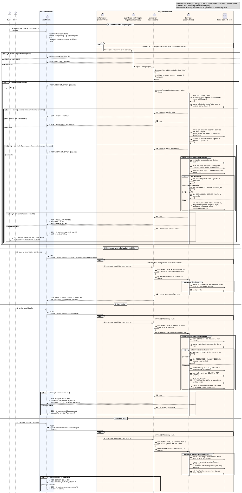

# Sequência 5: Solicitar reserva e aceite/recusa do Host

**Tipo:** 4, Contratação transacional (11 casos de uso). **Casos de uso representados:** HPET04 Solicitar Reserva e HPET12a Aceitar/Recusar Solicitação de Reserva. A parte 2 mostra também HPET12 Receber Solicitação de Reserva, que a matriz classifica como tipo 3 (consulta). **Situação:** as quatro rotas estão implementadas no back-end; no App, o botão "Solicitar reserva" ainda não faz nada e não existem telas do Host para as solicitações.

É o fluxo central do Hospetse. Mostra a solicitação do Tutor, a lista de pendentes do Host e as duas decisões possíveis, com o controle de concorrência que impede dois aceites de ocuparem a mesma vaga.

## Participantes

| Participante | Ícone | No código | Papel |
|---|---|---|---|
| Tutor | ator | — | pede a hospedagem |
| Host | ator | — | decide a solicitação |
| App Mobile | fronteira (`boundary`) | `hospetse-mobile` | telas do Tutor e do Host |
| Autenticação | controle (`control`) | `requireUser` | confere o token e carrega o usuário |
| Guarda de contratação | controle (`control`) | `requireCanContract` (`middlewares/can-contract.js`) | barra conta restrita ou perfil incompleto antes do controller |
| Controllers | fronteira (`boundary`) | `reservations/*.controller.js` | validam a requisição e montam a resposta |
| Services | controle (`control`) | `reservations/*.service.js`, `availability.js` | regras de negócio, travas e gravação |
| Banco do back-end | banco (`database`) | `reservations`, `services`, `providers`, `pets`, `provider_blocked_dates`, `hotel_details`, `notifications` | dados |

## Como ler os símbolos

- **Seta cheia:** uma chamada. **Seta tracejada:** a resposta. **Seta que volta ao mesmo participante:** trabalho interno.
- **Seta cinza:** passo planejado no App, ainda não implementado.
- **`alt`:** decisão do tipo "se/senão". Só um ramo acontece. Um `alt` pode ficar dentro de outro.
- **`ref`:** trecho já desenhado em outro diagrama, que não é repetido.
- **`group`:** agrupa passos com um nome. Aqui marca uma transação no banco: ou tudo vale, ou nada vale.

## Parte 1: o Tutor solicita a hospedagem

1. **Tutor → App (cinza):** escolhe o pet, o serviço do Host e o período.
2. **App → Autenticação (cinza):** `POST /api/v1/reservations`. O corpo traz `serviceId`, `petId`, `startDate`, `endDate` e `notes`. O header `Idempotency-Key` é um identificador que o App gera para essa intenção de solicitar e repete se precisar reenviar.

**`ref`: confere o JWT e carrega o usuário** (`401` ou `404`), como na sequência 3.

3. **Autenticação → Guarda de contratação:** repassa a requisição com `req.user`. A guarda roda em todo POST de contratação.

**`alt`: o usuário pode contratar?**

- *Ramo "conta bloqueada ou suspensa":* 4. **Guarda → App:** `403 ACCOUNT_RESTRICTED`. A conta restrita é conferida antes do perfil.
- *Ramo "perfil do Tutor incompleto":* 5. **Guarda → App:** `403 PROFILE_INCOMPLETE`.
- *Ramo "pode contratar":* o resto da parte 1 está dentro deste ramo.

6. **Guarda → Controller:** repassa a requisição.
7. **Controller → Controller:** `requireTutor`. Se o usuário ainda não é Tutor, responde `403`.
8. **Controller → Controller:** valida o header e todos os campos de uma vez. As regras: `Idempotency-Key` obrigatória com até 100 letras, números, `-` ou `_`; `serviceId` e `petId` em UUID; datas reais, entrada a partir de hoje e saída depois da entrada; `notes` com até 1000 caracteres; campo fora do contrato, como `tutorId`, é recusado.

**`alt`: os campos são válidos?**

- *Ramo "algum campo inválido":* 9. **Controller → App:** `400 VALIDATION_ERROR` com cada campo e o motivo.
- *Ramo "campos válidos":*

10. **Controller → Service:** `createReservationService(user, tutor, dados)`.
11. **Service → Service:** `assertCanContract(user)` repete a regra da guarda. Assim a regra vale mesmo se uma rota nova esquecer o middleware.
12. **Service → Banco:** procura uma solicitação deste Tutor com a mesma `Idempotency-Key`.

**`alt`: essa chave já foi usada?**

- *Ramo "chave já usada com a mesma intenção (reenvio)":* mesmo serviço, pet, período e observações.
  13. **Service → Controller:** devolve a solicitação já criada.
  14. **Controller → App:** `200` com a mesma solicitação. O reenvio não cria uma segunda reserva.
- *Ramo "chave já usada com outros dados":*
  15. **Service → Controller:** erro.
  16. **Controller → App:** `409 IDEMPOTENCY_KEY_REUSED`.
- *Ramo "chave nova":*

17. **Service → Banco:** busca ao mesmo tempo o serviço e o pet. O serviço precisa estar ativo e ser de um Host elegível (hotel, ativo e aprovado). O pet precisa estar ativo e ser deste Tutor; o de outro Tutor responde como inexistente.
18. **Service → Service:** confere se o Host aceita a espécie, o porte e a raça do pet. Lista vazia no Host significa que ele aceita tudo.

**`alt`: serviço e pet servem?**

- *Ramo "serviço indisponível, pet não encontrado ou pet não aceito":*
  19. **Service → Controller:** erro com a lista de motivos.
  20. **Controller → App:** `400 VALIDATION_ERROR`.
- *Ramo "tudo certo":*

**`group`: transação no banco do back-end.** As verificações e a gravação acontecem juntas. Cada verificação interrompe a transação no primeiro problema, na ordem abaixo.

21. **Service → Banco:** conta os dias bloqueados do Host no período.
22. **Service → Banco:** `assertVacancy` busca as reservas que ocupam vaga no período e calcula, dia a dia, se alguma já atinge a capacidade do Host. Sem capacidade cadastrada, a capacidade é 1. A busca mostrou o Host como livre, mas ele pode ter lotado depois: por isso a vaga é conferida de novo aqui.
23. **Service → Banco:** `assertPetFree` confere se o pet já tem hospedagem no período, em qualquer Host.

**`alt` dentro da transação: o período está livre?**

- *Ramo "dia bloqueado":* 24. `409 PERIOD_UNAVAILABLE`.
- *Ramo "sem vaga em algum dia":* 25. `409 NO_CAPACITY`.
- *Ramo "pet já ocupado":* 26. `409 PET_ALREADY_BOOKED`.
- *Ramo "livre":* 27. **Service → Banco:** cria a solicitação com status `requested`. A diária (`dailyPrice`) é uma cópia do preço de hoje, para uma mudança de preço depois não alterar a solicitação. O total é a diária vezes o número de noites.

- **Observação:** se dois envios com a mesma chave chegarem juntos, o índice único `(tutorId, Idempotency-Key)` barra o segundo, e ele recebe a solicitação já criada com `200`.

**`alt`: como a transação terminou?**

- *Ramo "transação terminou com 409":* o erro desfaz a transação.
  28. **Service → Controller:** erro.
  29. **Controller → App:** `409 PERIOD_UNAVAILABLE`, `NO_CAPACITY` ou `PET_ALREADY_BOOKED`.
- *Ramo "solicitação criada":*

30. **Service → Controller:** `{ reservation, created: true }`.
31. **Controller → App:** `201` com a solicitação: `id`, `status: requested`, `hostId`, `dailyPrice`, `totalValue` e as datas.
32. **App → Tutor (cinza):** informa que o Host vai responder e que o pagamento só vem depois do aceite.

## Parte 2: o Host consulta as solicitações recebidas

33. **Host → App (cinza):** abre as solicitações pendentes.
34. **App → Autenticação (cinza):** `GET /api/v1/me/host/reservations?status=requested&page&pageSize`.

**`ref`: confere o JWT e carrega o usuário.**

35. **Autenticação → Controller:** repassa a requisição.
36. **Controller → Controller:** `requireHost` (`403 HOST_REQUIRED` se o usuário não é prestador) e valida os parâmetros (`400`). Por enquanto o único status aceito é `requested`.
37. **Controller → Service:** `listHostReservationsService(host.id, filtros)`.

**`group`: transação de leitura.**

38. **Service → Banco:** busca as solicitações dos serviços deste Host, da mais antiga para a mais nova. O filtro pelos serviços do próprio Host é o que impede um Host de ver as solicitações de outro.
39. **Service → Banco:** conta o total.

40. **Service → Controller:** `{ items, page, pageSize, total }`.
41. **Controller → App:** `200`. Do Tutor vem só o nome; do pet vem o que o Host precisa para decidir e cuidar, incluindo as observações médicas e de comportamento.

## Parte 3: o Host aceita

42. **Host → App (cinza):** aceita a solicitação.
43. **App → Autenticação (cinza):** `POST /api/v1/me/host/reservations/{id}/accept`, sem corpo.

**`ref`: confere o JWT e carrega o usuário.**

44. **Autenticação → Controller:** repassa a requisição.
45. **Controller → Controller:** `requireHost` (`403`) e confere se o `id` é um UUID. Se não for, responde `404` direto, sem consultar o banco.
46. **Controller → Service:** `acceptHostReservationService(host, id)`.

**`group`: transação no banco do back-end.**

47. **Service → Banco:** trava a linha do Host (`SELECT ... FOR UPDATE`).
    - **Observação:** dois aceites do mesmo Host esperam um pelo outro, e o segundo já conta a vaga ocupada pelo primeiro.
48. **Service → Banco:** busca a solicitação dentro dos serviços deste Host.

**`alt`: a solicitação pode ser aceita?**

- *Ramo "não encontrada ou de outro Host":* 49. `404 NOT_FOUND`. A de outro Host responde como inexistente.
- *Ramo "já decidida":* 50. `409 RESERVATION_ALREADY_DECIDED`.
- *Ramo "pendente":*
  51. **Service → Banco:** `assertVacancy` de novo. Responde `409 NO_CAPACITY` se o Host lotou depois do pedido.
  52. **Service → Banco:** trava a linha do pet.
      - **Observação:** a ordem é sempre Host e depois pet. Uma ordem fixa evita que duas transações fiquem esperando uma pela outra (deadlock).
  53. **Service → Banco:** `assertPetFree`. Responde `409 PET_ALREADY_BOOKED` se outro Host aceitou o mesmo pet antes.
  54. **Service → Banco:** muda o status para `awaiting_payment` e grava a data da decisão, só se a solicitação ainda estiver `requested`. Se duas decisões chegarem juntas, só uma consegue alterar a linha.

**`alt`: como a transação terminou?** Qualquer erro dos passos 49 a 54 desfaz a transação.

- *Ramo "transação terminou com erro":*
  55. **Service → Controller:** erro.
  56. **Controller → App:** `404 NOT_FOUND`, ou `409` com `RESERVATION_ALREADY_DECIDED`, `NO_CAPACITY` ou `PET_ALREADY_BOOKED`.
- *Ramo "solicitação aceita":*
  57. **Service → Controller:** `{ id, status, decidedAt }`.
  58. **Controller → App:** `200` com `status: awaiting_payment`.

## Parte 4: o Host recusa

59. **Host → App (cinza):** recusa e informa o motivo.
60. **App → Autenticação (cinza):** `POST /api/v1/me/host/reservations/{id}/reject` com `{ reason }`.

**`ref`: confere o JWT e carrega o usuário.**

61. **Autenticação → Controller:** repassa a requisição.
62. **Controller → Controller:** `requireHost` (`403`), `id` em UUID (`404`) e `reason` obrigatório com até 500 caracteres (`400`).
63. **Controller → Service:** `rejectHostReservationService(host, id, reason)`.

**`group`: transação no banco do back-end.**

64. **Service → Banco:** busca a solicitação nos serviços deste Host (`404` se não achar).
65. **Service → Banco:** muda para `rejected`, com o motivo e a data, só se ainda estiver `requested` (`409` se já foi decidida).
66. **Service → Banco:** cria uma notificação `reservation_rejected` para o Tutor, com o id da solicitação e o motivo. Como está na mesma transação, não existe recusa sem notificação.

**`alt`: como a transação terminou?**

- *Ramo "não encontrada ou já decidida":* 67. **Controller → App:** `404 NOT_FOUND` ou `409 RESERVATION_ALREADY_DECIDED`.
- *Ramo "solicitação recusada":* 68. **Controller → App:** `200` com `status: rejected` e o motivo.

## Observações finais

- **Estados:** `requested` vai para `awaiting_payment` (aceite) ou `rejected` (recusa). Depois do pagamento vêm `accepted`, `checked_in` e `checked_out`.
- **Ocupação:** só `awaiting_payment`, `accepted` e `checked_in` ocupam vaga. `requested` não ocupa, porque o Host ainda não decidiu.
- **Ainda não implementado:**
  - notificar o Host sobre a nova solicitação (HPET12) e o Tutor no aceite (HPET12a);
  - entregar as notificações gravadas (FT-026);
  - o prazo de 1 dia útil para o Host responder, previsto em HPET04 e HPET12a, ainda não tem processo automático implementado;
  - solicitação para Pet Sitter e Pet Walker (HPET05, HPET17a, HPET19);
  - check-in, registro de atividades e check-out (HPET12b, HPET12c, HPET12d).
