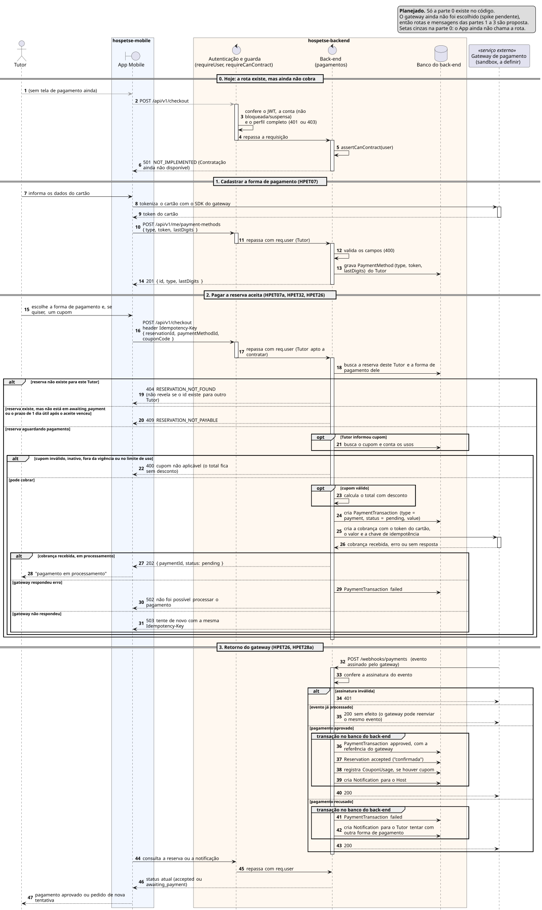

# Sequência 6: Pagamento e retorno do gateway

**Tipo:** 5, Pagamento com gateway (9 casos de uso). **Casos de uso representados:** HPET07 Cadastrar Forma de Pagamento, HPET07a Realizar Pagamento, HPET32 Aplicar Cupom, HPET26 Processar Pagamento e HPET28a Registrar Transação Financeira. **Situação:** planejado.

## O que existe no código hoje

- **Rota provisória:** `POST /api/v1/checkout` passa pela autenticação e pela guarda de contratação e responde `501 NOT_IMPLEMENTED` (`contracts/contracts.controller.js`). É a parte 0 do diagrama.
- **Tabelas no banco:** `payment_methods` (`type`, `token`, `lastDigits`), `payment_transactions` (`type`, `status`, `value`, ligações com reserva, prestador e forma de pagamento), `coupons` e `coupon_usages`. Nenhum código lê ou grava nelas ainda.
- **Estado da reserva:** o aceite do Host já deixa a reserva em `awaiting_payment` (sequência 5).
- **Gateway:** nenhum foi escolhido; o spike de comparação está pendente. Não existe cliente de gateway, webhook nem tela de pagamento no App.

Por isso as partes 1 a 3 são uma **proposta**: as rotas e os nomes podem mudar quando o gateway for escolhido. O Regulamento exige integração com uma API de pagamento em sandbox.

## Participantes

| Participante | Ícone | Papel |
|---|---|---|
| Tutor | ator | quem paga |
| App Mobile | fronteira (`boundary`) | telas de forma de pagamento e de pagamento |
| Autenticação e guarda | controle (`control`) | `requireUser` e `requireCanContract`, como na sequência 5 |
| Back-end (pagamentos) | controle (`control`) | regras do pagamento e registro das transações |
| Banco do back-end | banco (`database`) | formas de pagamento, transações, cupons e reservas |
| Gateway de pagamento | participante com estereótipo «serviço externo» | cobra o cartão em sandbox e avisa o resultado |

## Como ler os símbolos

- **Seta cheia:** uma chamada. **Seta tracejada:** a resposta. **Seta que volta ao mesmo participante:** trabalho interno.
- **`alt`:** "se/senão", só um ramo acontece. **`opt`:** "se", sem senão: o conteúdo acontece ou é pulado.
- **`group`:** agrupa passos com um nome. Aqui marca uma transação no banco.
- **Seta cinza:** o App ainda não faz essa chamada.

## Parte 0: hoje, a rota existe mas não cobra (implementado)

1. **Tutor → App (cinza):** ainda não existe tela de pagamento.
2. **App → Autenticação e guarda (cinza):** `POST /api/v1/checkout`. A rota existe, mas o App ainda não a chama.
3. **Autenticação e guarda:** conferem o token, se a conta não está bloqueada ou suspensa e se o perfil está completo. Falha responde `401` ou `403`.
4. **Autenticação e guarda → Back-end:** repassam a requisição.
5. **Back-end → Back-end:** `assertCanContract(user)` repete a regra da guarda.
6. **Back-end → App:** `501 NOT_IMPLEMENTED`, contratação ainda não disponível.

## Parte 1: cadastrar a forma de pagamento (HPET07)

7. **Tutor → App:** informa os dados do cartão.
8. **App → Gateway:** o App usa o SDK do gateway para trocar o cartão por um token.
9. **Gateway → App:** devolve o token.
   - **Observação:** número e CVV vão direto do aparelho para o gateway. O back-end nunca recebe nem guarda dados do cartão, o que reduz o risco e as exigências de segurança do sistema.
10. **App → Autenticação:** `POST /api/v1/me/payment-methods` com `type`, `token` e `lastDigits`.
11. **Autenticação → Back-end:** repassa com o Tutor em `req.user`.
12. **Back-end → Back-end:** valida os campos (`400` se algo estiver errado).
13. **Back-end → Banco:** grava a forma de pagamento do Tutor.
14. **Back-end → App:** `201` com o id, o tipo e os quatro últimos dígitos.

## Parte 2: pagar a reserva aceita (HPET07a, HPET32, HPET26)

15. **Tutor → App:** escolhe a forma de pagamento e, se quiser, um cupom.
16. **App → Autenticação e guarda:** `POST /api/v1/checkout` com `reservationId`, `paymentMethodId` e `couponCode`, e o header `Idempotency-Key`, como na solicitação de reserva.
17. **Autenticação e guarda → Back-end:** repassam com o Tutor apto a contratar.
18. **Back-end → Banco:** busca a reserva e a forma de pagamento, as duas deste Tutor.

**`alt`: a reserva pode ser paga?**

- *Ramo "reserva não existe para este Tutor":* 19. **Back-end → App:** `404 RESERVATION_NOT_FOUND`. O checkout deve buscar pelo `reservationId` e pelo `tutorId` extraído do token. Assim, uma reserva de outro Tutor não é confundida nem revelada.
- *Ramo "reserva existe, mas não está em `awaiting_payment` ou o prazo de 1 dia útil após o aceite venceu":* 20. **Back-end → App:** `409 RESERVATION_NOT_PAYABLE`.
- *Ramo "reserva aguardando pagamento":* o resto da parte 2 está dentro deste ramo.

**`opt`: o Tutor informou cupom?** Sem cupom, o passo 21 é pulado.

21. **Back-end → Banco:** busca o cupom e conta quantas vezes já foi usado.

**`alt`: o cupom impede a cobrança?**

- *Ramo "inválido, inativo, fora da vigência ou no limite de uso":* 22. **Back-end → App:** `400`. O total continua sem desconto (HPET32).
- *Ramo "pode cobrar":*

**`opt`: cupom válido.**

23. **Back-end → Back-end:** calcula o total com desconto.

24. **Back-end → Banco:** cria a transação de pagamento com status `pending` e o valor.
25. **Back-end → Gateway:** cria a cobrança com o token do cartão, o valor e uma chave de idempotência. Se a chamada for repetida por falha de rede, o gateway não cobra duas vezes.
26. **Gateway → Back-end:** responde que recebeu a cobrança, responde com erro, ou não responde.

**`alt`: o que o gateway respondeu?**

- *Ramo "cobrança recebida, em processamento":* o resultado chega depois.
  27. **Back-end → App:** `202` com o id do pagamento e `status: pending`.
  28. **App → Tutor:** "pagamento em processamento".
- *Ramo "gateway respondeu erro":*
  29. **Back-end → Banco:** marca a transação como `failed`.
  30. **Back-end → App:** `502`, não foi possível processar o pagamento.
- *Ramo "gateway não respondeu":*
  - **Observação:** o resultado é desconhecido. A transação fica `pending`, e o webhook decide. Reenviar com a mesma chave não cobra duas vezes.
  31. **Back-end → App:** `503`, tente de novo com a mesma `Idempotency-Key`.

## Parte 3: retorno do gateway (HPET26, HPET28a)

32. **Gateway → Back-end:** `POST /webhooks/payments` com o resultado, assinado pelo gateway. Quem inicia esta parte é o gateway, não o Tutor.
33. **Back-end → Back-end:** confere a assinatura, que prova que o aviso veio do gateway.

**`alt`: o que fazer com o aviso?**

- *Ramo "assinatura inválida":* 34. **Back-end → Gateway:** `401`.
- *Ramo "evento já processado":* 35. **Back-end → Gateway:** `200` sem efeito. O gateway pode reenviar o mesmo aviso, e ele não pode confirmar a reserva duas vezes.
- *Ramo "pagamento aprovado":*
  - **`group` transação:** 36. transação `approved`, com a referência do gateway; 37. reserva `accepted` ("confirmada" no caso de uso); 38. registra o uso do cupom, se houver; 39. notificação para o Host.
  - 40. **Back-end → Gateway:** `200`.
- *Ramo "pagamento recusado":*
  - **`group` transação:** 41. transação `failed`; 42. notificação para o Tutor tentar com outra forma de pagamento.
  - **Observação:** a reserva continua em `awaiting_payment`. O Tutor tenta de novo sem refazer a solicitação (HPET07a). Como o uso do cupom só é gravado na aprovação, o mesmo cupom continua valendo na nova tentativa.
  - 43. **Back-end → Gateway:** `200`.

44. **App → Autenticação:** o App consulta a reserva ou a notificação.
45. **Autenticação → Back-end:** repassa com `req.user`.
46. **Back-end → App:** o status atual, `accepted` ou `awaiting_payment`.
47. **App → Tutor:** pagamento aprovado, ou o pedido de nova tentativa.

## Pontos de projeto que o código atual já mostra

- **Webhook e autenticação:** no `app.js`, tudo sob `/api/v1` exige o JWT de um usuário. O gateway não tem esse token, então o webhook precisa ficar fora do `/api/v1` ou ter uma autenticação própria pela assinatura.
- **Ledger:** `payment_transactions` ainda não tem a referência do gateway nem a chave de idempotência, e o status muda na mesma linha. HPET28a e HPET43 pedem que a correção vire um lançamento novo ligado ao original, sem alterar o registro antigo.
- **Cupom:** como o uso só é gravado na aprovação, `payment_transactions` precisa guardar o cupom aplicado até o retorno do gateway. Hoje a tabela não tem esse campo.
- **Prazo:** o cancelamento por falta de pagamento em 1 dia útil é uma regra prevista em HPET07a, mas não há processo agendado implementado no código. Se a cobrança estiver em processamento quando o prazo vencer, o cancelamento espera o retorno.

## Mesmo esqueleto nos outros casos do tipo 5

Estorno (HPET28) e repasse ao prestador, descontando a taxa da plataforma vigente na contratação (HPET27, HPET12f), seguem o mesmo caminho: o back-end chama o gateway, recebe o retorno e registra a transação. O que falha vai para o Administrador tratar (HPET43).
