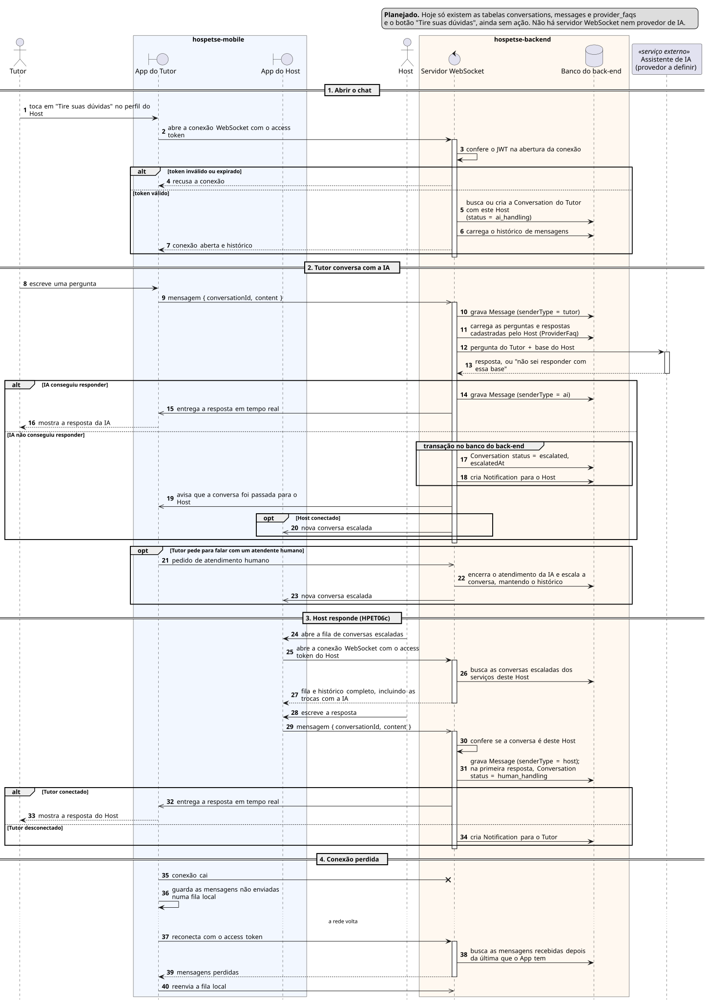

# Sequência 7: Chat com IA e escalonamento

**Tipo:** 6, Tempo real com WebSocket e IA (2 casos de uso). **Casos de uso representados:** HPET06 Conversar com Host e HPET06c Gerenciar Conversas Escaladas pela IA. **Situação:** planejado.

## O que existe no código hoje

- **Tabelas no banco:** `conversations` (Tutor, prestador, reserva opcional, `status` com padrão `ai_handling` e `escalatedAt`), `messages` (`senderType` `tutor`, `host` ou `ai`, conteúdo e data) e `provider_faqs` (perguntas e respostas do Host). Nenhum código lê ou grava nelas.
- **App:** o perfil do Host tem o botão "Tire suas dúvidas", ainda sem ação.
- **Não existe:** servidor WebSocket, biblioteca de WebSocket nas dependências, nem provedor de IA escolhido.

O diagrama descreve o fluxo pedido pelos casos de uso. O Regulamento exige pelo menos um caso de uso com WebSocket, e este é o do Hospetse. Os status usados aqui já existem no CHECK da migration (`ai_handling`, `escalated`, `human_handling` e `closed`), mas nenhum código os altera ainda.

## Participantes

| Participante | Ícone | Papel |
|---|---|---|
| Tutor | ator | faz as perguntas |
| App do Tutor | fronteira (`boundary`) | tela do chat do Tutor |
| App do Host | fronteira (`boundary`) | fila de conversas escaladas do Host |
| Host | ator | responde quando a IA não consegue |
| Servidor WebSocket | controle (`control`) | mantém as conexões abertas, grava e entrega as mensagens |
| Banco do back-end | banco (`database`) | conversas, mensagens, base de perguntas e notificações |
| Assistente de IA | participante com estereótipo «serviço externo» | responde com base no que o Host cadastrou |

## Como ler os símbolos

- **Seta cheia com ponta fechada:** chamada síncrona, que espera resposta.
- **Seta com ponta aberta (`->>`):** mensagem assíncrona. Quem envia não fica esperando; é o normal num chat.
- **Seta tracejada:** resposta. **Seta terminada em X:** mensagem perdida, a conexão caiu.
- **Três pontos na vertical (`...`):** passa um tempo sem nada acontecer.
- **`alt`:** "se/senão", só um ramo acontece. **`opt`:** "se", sem senão.
- **`group`:** agrupa passos com um nome. Aqui marca uma transação no banco.

## Parte 1: abrir o chat

1. **Tutor → App do Tutor:** toca em "Tire suas dúvidas" no perfil do Host.
2. **App do Tutor → Servidor WebSocket:** abre a conexão, enviando o access token.
3. **Servidor → Servidor:** confere o JWT uma vez, na abertura. Depois disso a conexão fica aberta, e as mensagens não precisam mandar o token de novo.

**`alt`: o token é válido?**

- *Ramo "token inválido ou expirado":* 4. **Servidor → App do Tutor:** recusa a conexão.
- *Ramo "token válido":*
  5. **Servidor → Banco:** busca a conversa do Tutor com este Host, ou cria uma com status `ai_handling` (a IA atende primeiro).
  6. **Servidor → Banco:** carrega o histórico de mensagens.
  7. **Servidor → App do Tutor:** conexão aberta e histórico.

## Parte 2: o Tutor conversa com a IA

8. **Tutor → App do Tutor:** escreve uma pergunta.
9. **App do Tutor → Servidor (assíncrono):** envia a mensagem com o id da conversa e o texto.
10. **Servidor → Banco:** grava a mensagem com `senderType = tutor`.
11. **Servidor → Banco:** carrega as perguntas e respostas que o Host cadastrou (HPET06b).
12. **Servidor → Assistente de IA:** envia a pergunta junto com a base do Host. A IA só pode responder com o que o Host informou.
13. **Assistente de IA → Servidor:** devolve uma resposta, ou indica que a base não cobre a pergunta.

**`alt`: a IA conseguiu responder?**

- *Ramo "IA conseguiu responder":*
  14. **Servidor → Banco:** grava a resposta com `senderType = ai`.
  15. **Servidor → App do Tutor:** entrega a resposta em tempo real.
  16. **App do Tutor → Tutor:** mostra a resposta.
- *Ramo "IA não conseguiu responder":*
  - **`group` transação:** 17. muda a conversa para escalada e grava `escalatedAt`; 18. cria uma notificação para o Host. As duas coisas acontecem juntas.
  19. **Servidor → App do Tutor:** avisa que a conversa foi passada para o Host.
  - **`opt` "Host conectado":** 20. **Servidor → App do Host:** avisa em tempo real que há uma nova conversa escalada. Se o Host não estiver conectado, ele vê pela notificação do passo 18.

**`opt`: o Tutor pede para falar com um atendente humano?** Pode acontecer a qualquer momento.

21. **App do Tutor → Servidor:** pedido de atendimento humano.
22. **Servidor → Banco:** encerra o atendimento da IA e escala a conversa, mantendo o histórico.
23. **Servidor → App do Host:** nova conversa escalada.

## Parte 3: o Host responde (HPET06c)

24. **Host → App do Host:** abre a fila de conversas escaladas.
25. **App do Host → Servidor:** abre a conexão com o access token do Host.
26. **Servidor → Banco:** busca as conversas escaladas dos serviços deste Host.
27. **Servidor → App do Host:** a fila e o histórico completo, incluindo as trocas com a IA.
28. **Host → App do Host:** escreve a resposta.
29. **App do Host → Servidor (assíncrono):** envia a mensagem.
30. **Servidor → Servidor:** confere se a conversa é deste Host, para um Host não escrever na conversa de outro.
31. **Servidor → Banco:** grava a mensagem com `senderType = host`. Na primeira resposta, muda a conversa para `human_handling`.

**`alt`: o Tutor está conectado?**

- *Ramo "Tutor conectado":* 32. **Servidor → App do Tutor:** entrega a resposta em tempo real; 33. **App do Tutor → Tutor:** mostra a resposta.
- *Ramo "Tutor desconectado":* 34. **Servidor → Banco:** cria uma notificação para o Tutor.

## Parte 4: conexão perdida

35. **App do Tutor → Servidor:** a conexão cai (seta com X).
36. **App do Tutor → App do Tutor:** guarda as mensagens não enviadas numa fila local.
- **`...` a rede volta.**
37. **App do Tutor → Servidor:** reconecta com o access token.
38. **Servidor → Banco:** busca as mensagens recebidas depois da última que o App tem.
39. **Servidor → App do Tutor:** entrega as mensagens perdidas.
40. **App do Tutor → Servidor:** reenvia a fila local.

## Regras e pontos de projeto

- **Reserva não ativa:** o Tutor não envia mais mensagens diretas ao Host, mas a IA continua disponível se o Host permitir (HPET06).
- **Denúncia:** só a mensagem denunciada vai para a moderação, sem expor o resto da conversa (HPET36, HPET42).
- **Autenticação:** o `requireUser` atual protege só as rotas HTTP. A conexão WebSocket precisa conferir o JWT na abertura (passos 3 e 25).
- **Back-end stateless:** o Regulamento pede back-end stateless. Com mais de uma instância, o Tutor e o Host podem estar conectados em instâncias diferentes, então as mensagens precisam passar por um canal compartilhado (pub/sub).
- **Base da IA:** a configuração das perguntas e respostas pelo Host (HPET06b) é um CRUD do tipo 2 (sequência 3).
