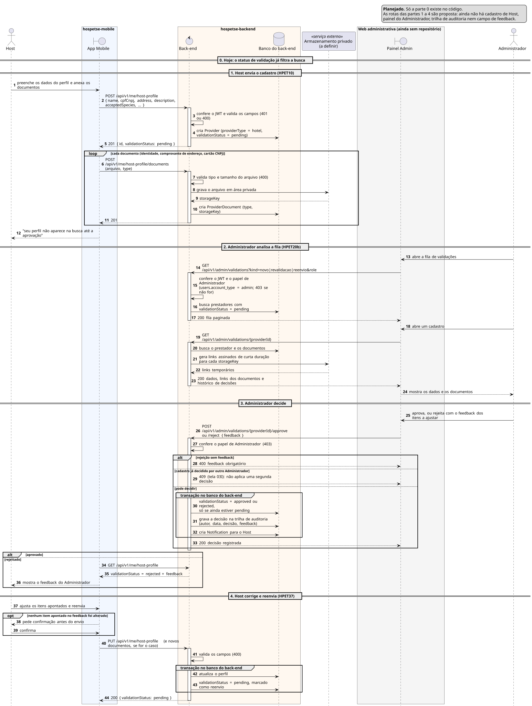

# Sequência 8: Validação de prestador

**Tipo:** 7, Decisão administrativa com auditoria (12 casos de uso). **Casos de uso representados:** HPET10 Cadastrar Perfil de Host, HPET20b Validar Cadastro de Host/Prestador e HPET37 Corrigir e Reenviar Cadastro Rejeitado. **Situação:** planejado; só a parte 0 existe no código.

## O que existe no código hoje

- **Status de validação:** `providers.validation_status`, com `pending` (padrão), `approved` ou `rejected`.
- **Documentos:** a tabela `provider_documents` (migration de 31/10/2026, #323) guarda o tipo (`identity`, `proof_of_address` ou `cnpj_card`) e uma `storage_key`, que é a chave do arquivo num armazenamento privado. O documento nunca tem URL pública: só sai por link assinado.
- **Efeito na busca:** a busca de Hosts e a solicitação de reserva só aceitam Host com `validation_status = approved` (`ELIGIBLE_HOST` em `hosts/host-policy.js`).
- **Papel de Administrador:** o campo `users.account_type` aceita `admin`, mas nenhuma rota confere esse papel.

**Ainda não existe:** rota de cadastro do Host, rota de envio de documentos (#324), qualquer rota do Administrador, tabela da trilha de auditoria, coluna para o feedback da rejeição, marcação de reenvio e o próprio painel web, que ainda não tem repositório. As rotas das partes 1 a 4 são proposta.

## Participantes

| Participante | Ícone | Papel |
|---|---|---|
| Host | ator | envia o cadastro e os documentos |
| App Mobile | fronteira (`boundary`) | telas de cadastro do Host |
| Back-end | controle (`control`) | regras do cadastro e da decisão |
| Banco do back-end | banco (`database`) | prestadores, documentos, auditoria e notificações |
| Armazenamento privado | participante com estereótipo «serviço externo» | guarda os arquivos dos documentos |
| Painel Admin | fronteira (`boundary`) | área web do Administrador |
| Administrador | ator | analisa e decide |

## Como ler os símbolos

- **Seta cheia:** uma chamada. **Seta tracejada:** a resposta. **Seta que volta ao mesmo participante:** trabalho interno.
- **`loop`:** passos repetidos para cada item. **`alt`:** "se/senão", só um ramo acontece. **`opt`:** "se", sem senão.
- **`group`:** agrupa passos com um nome. Aqui marca uma transação no banco.

## Parte 0: hoje, o status de validação já filtra a busca

Esta parte descreve o que o banco já tem e o efeito na busca, como na seção acima. Não há passos numerados.

## Parte 1: o Host envia o cadastro (HPET10)

1. **Host → App:** preenche os dados do perfil e anexa os documentos.
2. **App → Back-end:** `POST /api/v1/me/host-profile` com nome, CPF/CNPJ, endereço, descrição e as espécies, portes e raças aceitos.
3. **Back-end → Back-end:** confere o JWT e valida os campos (`401` ou `400`).
4. **Back-end → Banco:** cria o prestador com `providerType = hotel` e `validationStatus = pending`.
5. **Back-end → App:** `201` com o id e o status `pending`.

**`loop`: para cada documento** (identidade, comprovante de endereço, cartão CNPJ):

6. **App → Back-end:** envia o arquivo e o tipo.
7. **Back-end → Back-end:** valida o tipo e o tamanho do arquivo (`400`).
8. **Back-end → Armazenamento:** grava o arquivo numa área privada.
9. **Armazenamento → Back-end:** devolve a `storageKey`.
10. **Back-end → Banco:** grava o documento com o tipo e a `storageKey`, nunca com uma URL.
11. **Back-end → App:** `201`.

12. **App → Host:** avisa que o perfil não aparece na busca até ser aprovado.

## Parte 2: o Administrador analisa a fila (HPET20b)

13. **Administrador → Painel:** abre a fila de validações.
14. **Painel → Back-end:** `GET /api/v1/admin/validations`, com filtro por tipo (novo, revalidação ou reenvio) e por papel.
15. **Back-end → Back-end:** confere o JWT e o papel de Administrador (`account_type = admin`). Quem não é Administrador recebe `403`.
16. **Back-end → Banco:** busca os prestadores com `validationStatus = pending`.
17. **Back-end → Painel:** `200` com a fila paginada.
18. **Administrador → Painel:** abre um cadastro.
19. **Painel → Back-end:** `GET /api/v1/admin/validations/{providerId}`.
20. **Back-end → Banco:** busca o prestador e os documentos.
21. **Back-end → Armazenamento:** pede um link assinado de curta duração para cada `storageKey`.
22. **Armazenamento → Back-end:** devolve os links temporários. Depois de alguns minutos eles param de funcionar, então um link copiado não dá acesso permanente ao documento.
23. **Back-end → Painel:** `200` com os dados, os links e o histórico de decisões.
24. **Painel → Administrador:** mostra os dados e os documentos.

## Parte 3: o Administrador decide

25. **Administrador → Painel:** aprova, ou rejeita com o feedback dos itens a ajustar.
26. **Painel → Back-end:** `POST /api/v1/admin/validations/{providerId}/approve`, ou `/reject` com `{ feedback }`.
27. **Back-end → Back-end:** confere de novo o papel de Administrador (`403`).

**`alt`: a decisão pode ser aplicada?**

- *Ramo "rejeição sem feedback":* 28. **Back-end → Painel:** `400`, o feedback é obrigatório. Sem ele, o Host não saberia o que corrigir.
- *Ramo "cadastro já decidido por outro Administrador":* 29. **Back-end → Painel:** `409` (tela 03I). Não aplica uma segunda decisão.
- *Ramo "pode decidir":*
  - **`group` transação:**
    30. muda o status para `approved` ou `rejected`, só se ainda estiver `pending`. Se dois Administradores decidirem ao mesmo tempo, só um consegue (é o que gera o `409` do outro);
    31. grava a decisão na trilha de auditoria, com autor, data, decisão e feedback;
    32. cria uma notificação para o Host.
  - 33. **Back-end → Painel:** `200`, decisão registrada.

**`alt`: qual foi a decisão?**

- *Ramo "aprovado":* o Host passa a aparecer na busca e a poder receber solicitações, porque agora atende ao `ELIGIBLE_HOST`.
- *Ramo "rejeitado":*
  34. **App → Back-end:** `GET /api/v1/me/host-profile`.
  35. **Back-end → App:** `validationStatus = rejected` com o feedback.
  36. **App → Host:** mostra o feedback do Administrador.

## Parte 4: o Host corrige e reenvia (HPET37)

37. **Host → App:** ajusta os itens apontados e reenvia.

**`opt`: nenhum item apontado no feedback foi alterado?** Se o Host mexeu em algum item apontado, os passos 38 e 39 são pulados.

38. **App → Host:** pede confirmação antes de enviar.
39. **Host → App:** confirma.

40. **App → Back-end:** `PUT /api/v1/me/host-profile`, com novos documentos se for o caso.
41. **Back-end → Back-end:** valida os campos (`400`).

**`group`: transação no banco do back-end.**

42. **Back-end → Banco:** atualiza o perfil.
43. **Back-end → Banco:** volta o status para `pending` e marca o cadastro como reenvio.

44. **Back-end → App:** `200` com `validationStatus: pending`.

- **Observação:** o cadastro volta para a fila da parte 2, agora com o tipo "reenvio".

## Mesmo esqueleto nos 12 casos do tipo 7

Um item entra numa fila (cadastro, denúncia ou ocorrência), o Administrador decide, a decisão vai para a trilha de auditoria, o estado muda e a parte envolvida é notificada. As variações:

- **Penalidade com prazo:** HPET25 aplica e HPET25a acompanha e reverte. O fim automático da suspensão é uma regra prevista, mas não há processo agendado implementado no código.
- **Moderação:** HPET42 decide sobre o conteúdo denunciado, e HPET42a pede acesso à conversa completa.
- **Reativação de conta:** HPET20.
- **Outros prestadores:** Pet Sitter (HPET16) e Pet Walker (HPET18) seguem este mesmo fluxo, com o `providerType` deles.
