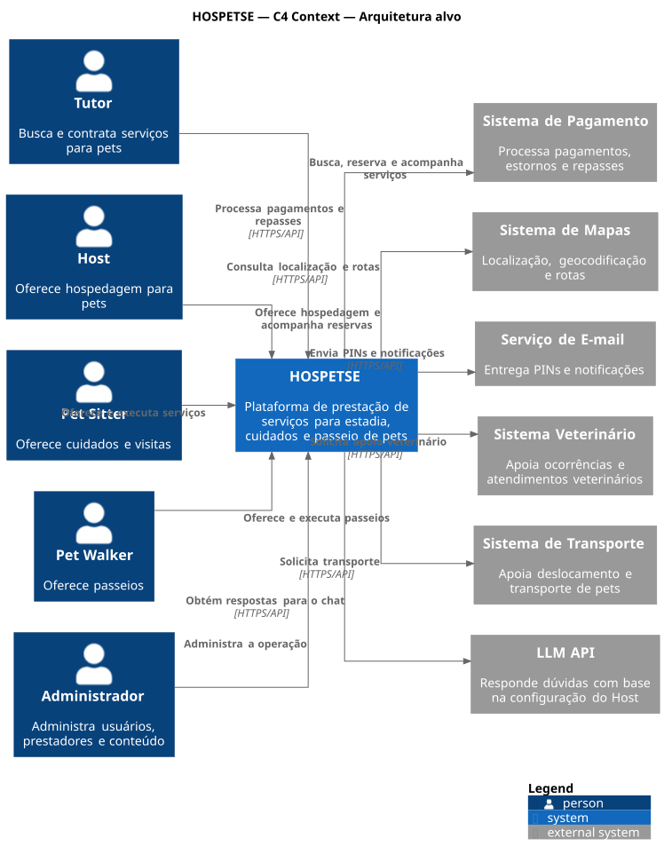
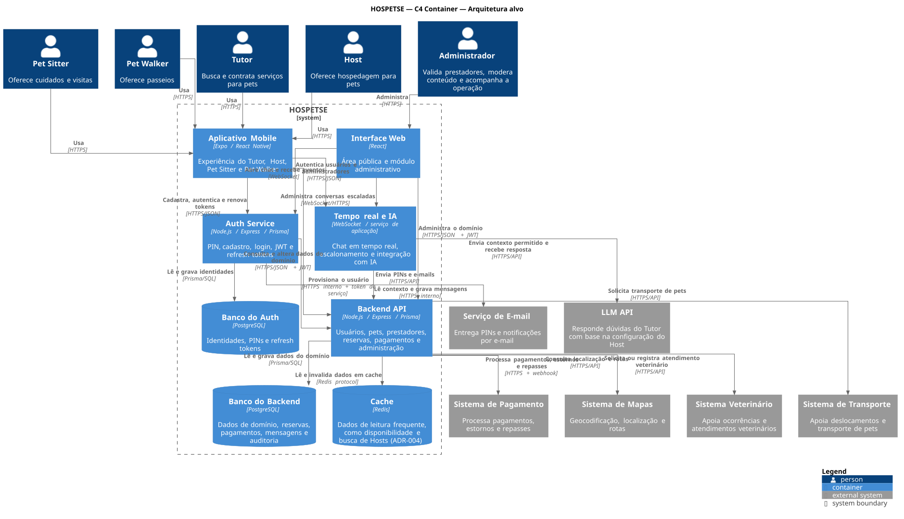
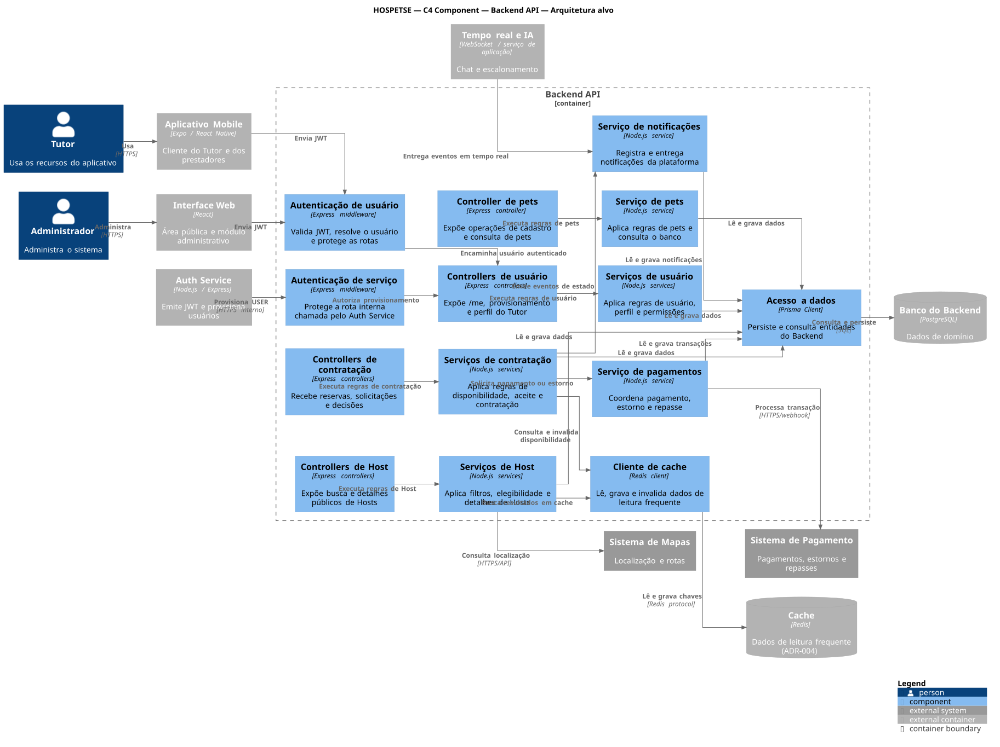

# Diagramas C4

Os diagramas seguem o [modelo C4](https://c4model.com) e representam a **arquitetura alvo** do Hospetse, incluindo integrações que ainda serão implementadas. Cada nível amplia o anterior. O diagrama de Código foi descartado pelo time, porque o [Diagrama de Classes](../../04-modelagem/classes) já cobre esse nível.

## Nível 1 — Contexto

Usuários do Hospetse e sistemas externos com que ele se comunica.

## Nível 2 — Containers

Aplicações e armazenamentos de dados. Auth Server e back-end têm bancos PostgreSQL separados (ADR-011). O Redis é a camada de cache do back-end (ADR-004). Os serviços são publicados no Railway (ADR-007).

## Nível 3 — Componentes do Backend API

Organização interna do back-end por domínio, com controllers, services e acesso a dados (ADR-015).

Fonte: os arquivos `.puml` desta pasta, com a biblioteca C4-PlantUML. As decisões citadas estão nos ADRs da [Wiki #55](https://dev.azure.com/escola-ti/Hospetse/_wiki/wikis/Hospetse.wiki/55).
