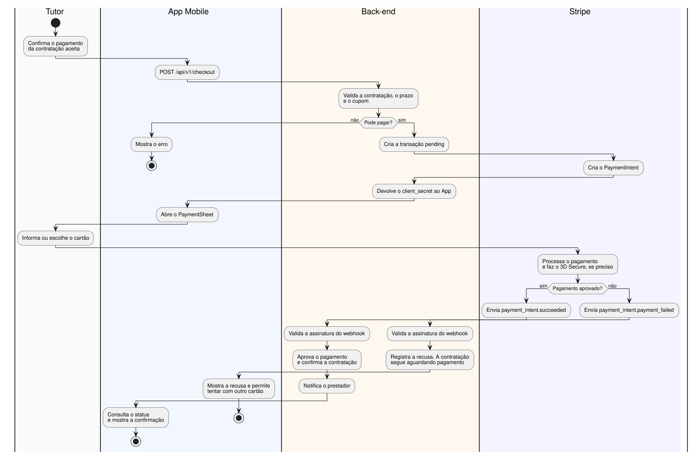

# Documento de Integração de Pagamento do Hospetse

| Campo | Valor |
|---|---|
| Work item | #511 HSP-PBI-081-TSK-05 |
| Gateway | Stripe, em ambiente de teste (sandbox) |
| Situação | Proposta, aguardando revisão. A integração ainda não foi implementada nem testada |
| Data | 02/11/2026 |

Este documento resume as decisões e regras da integração. Os detalhes de implementação estão na documentação oficial, indicada em cada seção.

## 1. Objetivo

O Regulamento ETI 2026 exige:

> Integração com uma API de pagamento em ambiente de teste/homologação (A integração fica a critério do time, Mercado Pago, abacate pay, stripe, etc)

## 2. Decisão de gateway

**Proposta:** usar o Stripe, porque ele atende o fluxo do Hospetse sem controles extras:

- o PaymentSheet envia os dados do cartão direto do App ao Stripe;
- a API aceita `Idempotency-Key` nas cobranças;
- os webhooks são assinados;
- a sandbox tem cartões de teste para aprovação, recusa, 3D Secure e estorno.

O Asaas foi a principal alternativa. Ele tem split nativo, mas não encontrei SDK para tokenizar no App nem header de idempotência na cobrança, e o webhook usa token fixo em vez de assinatura.

A decisão precisa virar o **ADR-016**, que também registra a exceção ao ADR-013: o padrão do projeto é Axios, e aqui o SDK oficial traz a validação de assinatura, a repetição segura e os tipos de erro.

## 3. Escopo

**Entra:**

- cartão de crédito e débito;
- cadastro de forma de pagamento (HPET07);
- pagamento de hospedagem, visita e passeio, com cupom (HPET07a, HPET26, HPET32);
- pagamento complementar de custos extras (HPET07a);
- estorno integral ou parcial (HPET04a, HPET28);
- registro imutável das transações (HPET28a);
- repasse simulado no ledger (HPET12f, HPET27);
- tratamento de transações com falha pelo Administrador (HPET43).

**Fica fora:**

| Item | Motivo |
|---|---|
| Pix | Para empresa no Brasil, é só para convidados ([preços](https://stripe.com/pt-br/pricing/local-payment-methods), [suporte](https://docs.stripe.com/payments/payment-methods/payment-method-support.md)) |
| Boleto, Apple Pay e Google Pay | Não são exigidos |
| Stripe Connect | Sem confirmação de plataforma brasileira. O Regulamento é atendido pela cobrança e pelo estorno |

## 4. Como funciona



**Regra central:** a contratação só é confirmada pelo webhook, nunca pelo retorno do App.

| Componente | Responsabilidade |
|---|---|
| App Mobile | Abre o PaymentSheet e mostra o resultado |
| Back-end | Valida a contratação, calcula o valor, fala com o Stripe, recebe o webhook e muda os estados |
| Auth Server | Só emite o JWT. Não participa do pagamento |
| Stripe | Guarda os dados do cartão, processa a cobrança e avisa o resultado |

O código novo fica em `src/payments/`, seguindo o ADR-015.

## 5. Regras de cada fluxo

| Fluxo | Regra | Documentação oficial |
|---|---|---|
| Cadastrar forma de pagamento | `SetupIntent` no App. O banco guarda só `pm_...`, os últimos dígitos e o tipo. Exige consentimento do Tutor | [Configurar pagamentos futuros](https://docs.stripe.com/payments/save-and-reuse.md), [salvar forma de pagamento](https://docs.stripe.com/payments/save-during-payment.md?payment-ui=elements) |
| Pagar | O valor vem do banco, nunca do App. Só paga contratação em `awaiting_payment`, dentro de 1 dia útil após o aceite. Vale para hospedagem, visita e passeio | [Pagamento no React Native](https://docs.stripe.com/payments/accept-a-payment.md?payment-ui=mobile&platform=react-native) |
| Receber o webhook | Rota `POST /webhooks/stripe`, fora do `/api/v1`, com corpo bruto e assinatura validada. Grava o `event.id` junto com o efeito, para ignorar repetição | [Webhooks](https://docs.stripe.com/webhooks.md) |
| Recusa | A contratação segue em `awaiting_payment`, com mensagem genérica. A nova tentativa usa o mesmo `PaymentIntent`, então não há duas cobranças abertas | [Ciclo de vida](https://docs.stripe.com/payments/paymentintents/lifecycle.md) |
| Prazo vencido | Cancela o `PaymentIntent` e a contratação, libera a agenda e notifica as partes. O mecanismo será definido no desenvolvimento | [Cancelar pagamento](https://docs.stripe.com/refunds.md#cancel-payment) |
| Pagamento tardio | Aprovado com a contratação já fora de `awaiting_payment`: registra e estorna integralmente | [Reembolsos](https://docs.stripe.com/refunds.md) |
| Estorno | Sempre é uma nova linha ligada ao pagamento. Na falha, fica `failed`, sem declarar devolução inexistente | [Reembolsos](https://docs.stripe.com/refunds.md) |
| Pagamento complementar | `PaymentIntent` próprio para o custo extra. O Tutor autoriza no App, e a contratação não muda de status | [Pagamento no React Native](https://docs.stripe.com/payments/accept-a-payment.md?payment-ui=mobile&platform=react-native) |
| Repasse simulado | Só por solicitação do prestador, com o serviço concluído, descontando a taxa da contratação. Fica no ledger, sem chamar o Stripe | [Tipos de cobrança no Connect](https://docs.stripe.com/connect/charges.md), para evolução futura |
| Transação com falha | O Administrador reprocessa ou resolve com justificativa. Sempre cria nova linha e grava na auditoria | [Erros e reconciliação](https://docs.stripe.com/error-low-level.md) |

## 6. Configuração

| Variável | Onde | Valor |
|---|---|---|
| `STRIPE_SECRET_KEY` | Back-end, Railway | Chave restrita `rk_test_...`, secreta |
| `STRIPE_WEBHOOK_SECRET` | Back-end, Railway | `whsec_...`, secreta |
| `EXPO_PUBLIC_STRIPE_PUBLISHABLE_KEY` | App | `pk_test_...`, pública |

**Eventos do webhook (formato Snapshot):** `payment_intent.succeeded`, `payment_intent.payment_failed`, `payment_intent.canceled`, `payment_method.attached`, `refund.updated` e `refund.failed`.

**URL do webhook:** `https://backend-production-7298.up.railway.app/webhooks/stripe`. Em desenvolvimento, usar `stripe listen`.

Documentação oficial: [sandboxes](https://docs.stripe.com/sandboxes.md), [chaves de API](https://docs.stripe.com/keys.md), [versão da API](https://docs.stripe.com/upgrades.md), [Stripe no Expo](https://docs.expo.dev/versions/latest/sdk/stripe).

## 7. Rotas (proposta)

| Rota | Quem acessa | Uso |
|---|---|---|
| `POST /api/v1/me/payment-methods/setup` | Tutor | Prepara o cadastro da forma de pagamento |
| `GET /api/v1/me/payment-methods` | Tutor | Lista as formas de pagamento |
| `PUT /api/v1/me/payment-methods/{id}/default` | Tutor | Define a forma padrão |
| `POST /api/v1/coupons/validate` | Tutor | Valida o cupom e devolve o total |
| `POST /api/v1/checkout` | Tutor apto a contratar | Inicia ou retoma o pagamento, com `Idempotency-Key` |
| `GET /api/v1/reservations/{id}/payment` | Dono da contratação | Consulta o estado do pagamento |
| `POST /api/v1/me/extra-costs/{id}/payment` | Tutor | Inicia o pagamento complementar |
| `POST /api/v1/me/reservations/{id}/cancel` | Tutor | Cancela e aciona o estorno, se houver pagamento |
| `GET /api/v1/me/payments` | Tutor | Extrato (HPET07b) |
| `GET /api/v1/me/provider/finance` | Prestador | Financeiro (HPET12e) |
| `POST /api/v1/me/provider/payouts` | Prestador | Solicita o repasse (HPET12f) |
| `GET /api/v1/admin/financial/transactions` | Administrador | Financeiro e falhas (HPET43, HPET46) |
| `POST /api/v1/admin/financial/transactions/{id}/reprocess` | Administrador | Reprocessa, com justificativa |
| `POST /api/v1/admin/financial/transactions/{id}/resolve` | Administrador | Resolve manualmente, com justificativa |
| `POST /webhooks/stripe` | Stripe, por assinatura | Recebe os eventos |

Pagamento complementar e cancelamento ficam sob `/me` porque a guarda de contratação barra todo `POST` sob `/api/v1/reservations` e `/api/v1/checkout`, e uma conta restrita ainda precisa conseguir acertar o que deve e cancelar.

O contrato completo entra no `docs/openapi.yaml` na implementação.

## 8. Estados

| `PaymentIntent` | Transação | Contratação |
|---|---|---|
| `requires_payment_method`, `requires_action`, `processing` | `pending` | `awaiting_payment` |
| `succeeded` | `approved` | `accepted` ("confirmada") |
| `canceled` | `rejected` | Sem mudança pelo evento |

| Tipo de transação | Início | Sucesso | Falha |
|---|---|---|---|
| `payment` | `pending` | `approved` | `rejected` |
| `refund` | `pending` | `completed` | `failed` |
| `payout` | `pending` | `completed` | `failed` |

Uma linha só muda ao sair de `pending` para o estado final. Depois disso, qualquer correção é uma nova linha (HPET28a).

## 9. Mudanças no banco

Registro para as migrations. Ao criar cada uma, preencher o nome e a data na última coluna.

| Tabela | Mudança | Motivo | Proposta em | Migration |
|---|---|---|---|---|
| `tutors` | `stripe_customer_id`, único | Liga o Tutor ao `Customer` | 02/11/2026 | Pendente |
| `payment_methods` | `is_default` | Forma padrão (HSP-PBI-066-AC-02) | 02/11/2026 | Pendente |
| `payment_methods` | `UNIQUE (token)` | Webhook repetido não duplica | 02/11/2026 | Pendente |
| `payment_transactions` | `stripe_payment_intent_id` e `stripe_refund_id` | Correlação com o Stripe | 02/11/2026 | Pendente |
| `payment_transactions` | `idempotency_key` e `UNIQUE (reservation_id, idempotency_key)` | Reenvio do checkout | 02/11/2026 | Pendente |
| `payment_transactions` | `coupon_id` e `discount_value` | Guarda o cupom até a aprovação | 02/11/2026 | Pendente |
| `payment_transactions` | `original_transaction_id` | Liga recusa, estorno e correção ao original (HPET28a) | 02/11/2026 | Pendente |
| `payment_transactions` | `failure_code` | Motivo técnico, sem dado do cartão | 02/11/2026 | Pendente |
| `payment_transactions` | `extra_cost_id` | Liga o pagamento ao custo extra | 02/11/2026 | Pendente |
| `payment_transactions` | `justification` e `resolved_by_user_id` | Resolução do Administrador (HPET43) | 02/11/2026 | Pendente |
| `payment_transactions` | Incluir `failed` no `CHECK` de status | Estorno e repasse com falha (HPET27, HPET28) | 02/11/2026 | Pendente |
| `payment_transactions` | Índices únicos parciais abaixo | Um pagamento ativo por contratação e por custo extra | 02/11/2026 | Pendente |
| `payment_events` (nova) | `id` (`evt_...`), `type` e `received_at` | Ignora evento repetido | 02/11/2026 | Pendente |
| `extra_costs` (nova) | `reservation_id`, `description`, `value`, `origin` e `status` (`open`, `paid`) | Pagamento complementar | 02/11/2026 | Pendente |
| Taxa da plataforma (nova) | Tabela de taxas com vigência | HPET41 | 02/11/2026 | Pendente |
| `reservations` | Cópia da taxa vigente na contratação | HPET27 e HPET41 | 02/11/2026 | Pendente |

```sql
CREATE UNIQUE INDEX payment_transactions_active_payment_idx
ON payment_transactions (reservation_id)
WHERE type = 'payment' AND extra_cost_id IS NULL AND status IN ('pending', 'approved');

CREATE UNIQUE INDEX payment_transactions_active_extra_cost_idx
ON payment_transactions (extra_cost_id)
WHERE type = 'payment' AND status IN ('pending', 'approved');
```

## 10. Segurança e consistência

- **Cartão:** número e CVV não passam pelo back-end nem vão para o banco.
- **Chaves:** as secretas ficam só no back-end, em variável de ambiente. O Railway usa só chaves de teste.
- **Webhook:** evento sem assinatura válida responde `400` e não muda nada.
- **Logs:** só código e status. Nunca `client_secret`, chave ou dados do Tutor.
- **Dados enviados ao Stripe:** só ids internos em `metadata`. CPF e endereço não vão.
- **Dono do recurso:** o Tutor vem do JWT, e a contratação de outro Tutor responde `404`.
- **Cobrança duplicada:** chave de idempotência no checkout e no Stripe, mais os índices da seção 9.
- **Resultado incerto:** em timeout, repetir com a mesma chave ou reconciliar antes de criar outra operação.

Documentação oficial: [idempotência](https://docs.stripe.com/api/idempotent_requests.md), [erros e reconciliação](https://docs.stripe.com/error-low-level.md), [tratamento de erros em Node.js](https://docs.stripe.com/error-handling.md?lang=node).

## 11. Testes

| Cenário | Cartão de teste |
|---|---|
| Aprovação | `4242 4242 4242 4242` |
| Aprovação com cartão do Brasil | `4000 0007 6000 0002` |
| Recusa genérica | `4000 0000 0000 0002` |
| Saldo insuficiente | `4000 0000 0000 9995` |
| 3D Secure | `4000 0027 6000 3184` |
| Estorno assíncrono | `4000 0000 0000 7726` |
| Estorno que falha | `4000 0000 0000 5126` |

**Cenários essenciais:**

1. A contratação só muda depois do webhook.
2. Reenvio do checkout com a mesma chave devolve o mesmo pagamento.
3. Webhook repetido não duplica o efeito.
4. Assinatura inválida responde `400`.
5. Depois de uma recusa, a nova tentativa aprova sem cobrar duas vezes.
6. Estorno com falha fica `failed` e aparece para o Administrador.

Documentação oficial: [testes](https://docs.stripe.com/testing.md).

## 12. Rastreabilidade

| Caso de uso | PBI | Azure |
|---|---|---|
| HPET07 | HSP-PBI-066 | #230 |
| HPET07a | HSP-PBI-067, HSP-PBI-068 | #234, #229 |
| HPET32 | HSP-PBI-069 | #227 |
| HPET26 | HSP-PBI-073 | #233 |
| HPET28, HPET04a | HSP-PBI-075 | #231 |
| HPET28a | HSP-PBI-076 | #232 |
| HPET12f, HPET27 | HSP-PBI-072, HSP-PBI-074 | #226, #228 |
| HPET43 | HSP-PBI-075, HSP-PBI-072 | #231, #226 |
| HPET07b | HSP-PBI-070 | #225 |
| HPET12e | HSP-PBI-071 | #224 |
| HPET05, HPET17a, HPET19 | HSP-PBI-043, HSP-PBI-044, HSP-PBI-045 | #200, #197, #204 |

## 13. Pendências

**Decisões:**

- Criar o ADR-016, com o gateway e a exceção ao ADR-013.
- Fechar `HSP-DEC-004` e `HSP-DEC-007`, que os casos de uso v2 já respondem.
- Definir a política de estorno e o valor mínimo (`HSP-DEC-006`). Provisório: estorno integral.
- Validar com o time o repasse simulado.
- Definir com a PO o prazo e a falta de pagamento do custo extra, e se ele entra no repasse.
- Definir o mecanismo do cancelamento por prazo.

**A confirmar na implementação:**

- SDK com Expo 58 e React Native 0.88, inclusive na web;
- PaymentSheet com `SetupIntent` e `customerSessionClientSecret`;
- saldo disponível em sandbox para testar estorno;
- permissões da chave restrita.

**Artefatos a atualizar:** o diagrama de sequência 06 (Stripe, `client_secret` e status `rejected`), o diagrama de classes, o `openapi.yaml` e o Documento de Ambientes (#512).

## 14. Referências

**Stripe:**

- [Pagamento no React Native](https://docs.stripe.com/payments/accept-a-payment.md?payment-ui=mobile&platform=react-native)
- [Webhooks](https://docs.stripe.com/webhooks.md)
- [Idempotência](https://docs.stripe.com/api/idempotent_requests.md)
- [Reembolsos](https://docs.stripe.com/refunds.md)
- [Testes](https://docs.stripe.com/testing.md)
- [Sandboxes](https://docs.stripe.com/sandboxes.md)
- [Chaves de API](https://docs.stripe.com/keys.md)
- [Stripe no Expo](https://docs.expo.dev/versions/latest/sdk/stripe)

**Projeto:**

- Regulamento ETI 2026 (`Regulamento - ETI.pdf`)
- [ADRs](https://dev.azure.com/escola-ti/Hospetse/_wiki/wikis/Hospetse.wiki?pagePath=/Index/Desenvolvimento/Arquitetura)
- [Casos de Uso V2](https://dev.azure.com/escola-ti/Hospetse/_wiki/wikis/Hospetse.wiki/78/CASOS-DE-USO-V2)
- `docs/backlog/epics/HSP-EP-004.md`
- `docs/diagramas-de-sequencia/06-pagamento-e-retorno-do-gateway.md`
